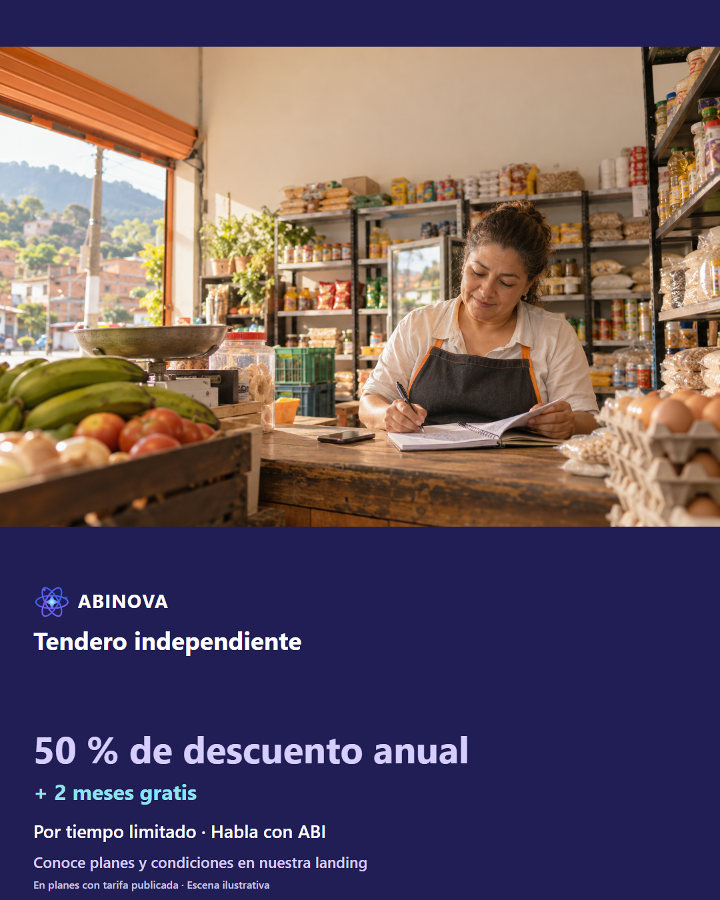

# Tendero independiente · instagram

Tres ángulos; copies A/B, guion narrado, storyboard y prompts de animación completos. Escenas ilustrativas, no testimonios ni videos grabados.

## Imágenes sugeridas locales

<!-- Fuente consolidada: 01-tendero-independiente-a1.md -->

# Tendero independiente · Instagram · Ángulo 1: El fiado necesita nombre

[Fotografía original](../../recursos/originales/01.png). Escena ilustrativa, no testimonio.

## Copy A · dolor

Mira el detalle: fiados sin cliente claro. Una compra a crédito queda apuntada solo como la vecina. Observa este contraste: Cuaderno con apodo frente a revisión con cliente registrado, sin datos personales. El campo que importa: Cliente registrado, una unidad y crédito siguen en la revisión. Preparar, aclarar, corregir, revisar y confirmar una vez con permisos. En ABINOVA puedes trabajar con el asistente operativo por voz o chat de administrador, según configuración y permisos. Si falta un dato o la referencia es ambigua, aclara y revisa. Solicita una demo de pedido y cartera. Visita el enlace del perfil y conversemos por WhatsApp. Ejemplo hipotético; operación sujeta a confirmación. ABI consulta, prepara y corrige con tus permisos; tú confirmas las operaciones. Usa créditos contratados con conexión asignada por el operador, tu propia API o un modelo local opcional según hardware y configuración. La base es 1.000 tokens por crédito, ponderados por modelo; se reserva el consumo y se concilia con el uso registrado. No equivale a mensajes ni es ilimitado. Tu API y el modo local no consumen ese cupo; el consumo de tu API corresponde a tu proveedor. ABINOVA: 50 % de descuento anual en planes con tarifa publicada + 2 meses gratis. Por tiempo limitado. Conoce las condiciones en la landing y habla con ABI.

## Copy B · solución

Así queda la revisión: el fiado necesita nombre. El pedido a crédito queda asociado al cliente tras confirmación. Observa este contraste: Cuaderno con apodo frente a revisión con cliente registrado, sin datos personales. El campo que importa: Cliente registrado, una unidad y crédito siguen en la revisión. Preparar, aclarar, corregir, revisar y confirmar una vez con permisos. En ABINOVA puedes trabajar con el asistente operativo por voz o chat de administrador, según configuración y permisos. Si falta un dato o la referencia es ambigua, aclara y revisa. Solicita una demo de pedido y cartera. Visita el enlace del perfil y conversemos por WhatsApp. Ejemplo hipotético; operación sujeta a confirmación. ABI consulta, prepara y corrige con tus permisos; tú confirmas las operaciones. Usa créditos contratados con conexión asignada por el operador, tu propia API o un modelo local opcional según hardware y configuración. La base es 1.000 tokens por crédito, ponderados por modelo; se reserva el consumo y se concilia con el uso registrado. No equivale a mensajes ni es ilimitado. Tu API y el modo local no consumen ese cupo; el consumo de tu API corresponde a tu proveedor. ABINOVA: 50 % de descuento anual en planes con tarifa publicada + 2 meses gratis. Por tiempo limitado. Conoce las condiciones en la landing y habla con ABI.

[STORYBOARD](#angulo-1-storyboard) · [PROMPTANIMACION](#angulo-1-prompt)

Verificar productos y cliente en catálogo QA. Crédito exige cliente registrado; ocasional solo efectivo/billetera. No inventar referencias ni ejecutar sobre negocio.

Asistente de voz/chat configurado; catálogo y referencias existentes; permisos de la sesión. Revisar y aclarar antes de confirmar. La interpretación puede requerir correcciones. No se garantiza entender toda instrucción.

---

<!-- Fuente consolidada: 01-tendero-independiente-a1-STORYBOARD.md -->

# Tendero independiente · Instagram · Ángulo 1: El fiado necesita nombre

[Fotografía original](../../recursos/originales/01.png). Escena ilustrativa, no testimonio.

## Enfoque A · 45 s

### Escena 1 · 0–4 s

- Cámara: Primer plano de objeto o etiqueta; macro de pantalla sin tapar datos clave
- Composición: Una compra a crédito queda apuntada solo como la vecina.
- Narración: «Mira el detalle: fiados sin cliente claro.»
- Subtítulo: «Mira el detalle: fiados sin cliente claro.»
- Evidencia: Editorial; no ejecución grabada.

### Escena 2 · 4–14 s

- Cámara: Detalle del objeto y etiqueta
- Composición: Cuaderno con apodo frente a revisión con cliente registrado, sin datos personales.
- Narración: «Observa el contraste de este caso: el fiado necesita nombre. ABI consulta, prepara y corrige con tus permisos; tú confirmas las operaciones.»
- Subtítulo: «Fiados sin cliente claro»
- Evidencia: Editorial; no ejecución grabada.

### Escena 3 · 14–24 s

- Cámara: Captura fija con acercamiento suave al campo; mantener legible la referencia
- Composición: Propuesta: escribir la instrucción en chat o dictarla con voz validada. Captura actual solo contextual.
- Narración: «Prepara un pedido para Ana Demo: dos arroces de una libra, a crédito y para preparar.»
- Subtítulo: «Prepara en voz o chat»
- Evidencia: Captura contextual disponible; acción específica propuesta por grabar; no ejecución grabada.

### Escena 4 · 24–32 s

- Cámara: Captura fija con acercamiento suave al campo; mantener legible la referencia
- Composición: Propuesta por grabar: corrección y nueva revisión; resaltar el cambio en explicación editorial fuera de la UI.
- Narración: «Cambia a un arroz de una libra y conserva cliente y crédito.»
- Subtítulo: «Corrige y revisa»
- Evidencia: Captura contextual disponible; acción específica propuesta por grabar; no ejecución grabada.

### Escena 5 · 32–39 s

- Cámara: Captura fija con acercamiento suave al campo; mantener legible la referencia
- Composición: Propuesta por grabar: revisión completa y confirmación. No representar guardado con las capturas actuales.
- Narración: «Comprueba cliente o condición ocasional, referencias, unidades y pago. Confirma una sola vez cuando esté completo.»
- Subtítulo: «Solo confirmar con datos completos»
- Evidencia: Captura contextual disponible; acción específica propuesta por grabar; no ejecución grabada.

### Escena 6 · 39–45 s

- Cámara: Captura fija con acercamiento suave al campo; mantener legible la referencia
- Composición: Pantalla de cierre tipográfica, nombre ABINOVA y CTA sin precios ni planes.
- Narración: «Solicita una demo de pedido y cartera. Conoce el beneficio anual de ABINOVA.»
- Subtítulo: «50 % de descuento anual + 2 meses gratis»
- Evidencia: Editorial; no ejecución grabada.

## Enfoque B · 47 s

### Escena 1 · 0–4 s

- Cámara: Primer plano de objeto o etiqueta; macro de pantalla sin tapar datos clave
- Composición: Vista previa editorial del resultado objetivo, rotulada ejemplo hipotético; la ejecución no está grabada.
- Narración: «Así queda la revisión: el fiado necesita nombre.»
- Subtítulo: «Así queda la revisión: el fiado necesita nombre.»
- Evidencia: Editorial; no ejecución grabada.

### Escena 2 · 4–16 s

- Cámara: Detalle del objeto y etiqueta
- Composición: Cuaderno con apodo frente a revisión con cliente registrado, sin datos personales.
- Narración: «El resultado a verificar: El pedido a crédito queda asociado al cliente tras confirmación. ABI consulta, prepara y corrige con tus permisos; tú confirmas las operaciones.»
- Subtítulo: «El fiado necesita nombre»
- Evidencia: Editorial; no ejecución grabada.

### Escena 3 · 16–26 s

- Cámara: Captura fija con acercamiento suave al campo; mantener legible la referencia
- Composición: Propuesta: escribir la instrucción en chat o dictarla con voz validada. Captura actual solo contextual.
- Narración: «Prepara un pedido para Ana Demo: dos arroces de una libra, a crédito y para preparar.»
- Subtítulo: «Prepara en voz o chat»
- Evidencia: Captura contextual disponible; acción específica propuesta por grabar; no ejecución grabada.

### Escena 4 · 26–34 s

- Cámara: Captura fija con acercamiento suave al campo; mantener legible la referencia
- Composición: Propuesta por grabar: corrección y nueva revisión; resaltar el cambio en explicación editorial fuera de la UI.
- Narración: «Cambia a un arroz de una libra y conserva cliente y crédito.»
- Subtítulo: «Corrige y revisa»
- Evidencia: Captura contextual disponible; acción específica propuesta por grabar; no ejecución grabada.

### Escena 5 · 34–41 s

- Cámara: Captura fija con acercamiento suave al campo; mantener legible la referencia
- Composición: Propuesta por grabar: revisión completa y confirmación. No representar guardado con las capturas actuales.
- Narración: «Comprueba cliente o condición ocasional, referencias, unidades y pago. Confirma una sola vez cuando esté completo.»
- Subtítulo: «Solo confirmar con datos completos»
- Evidencia: Captura contextual disponible; acción específica propuesta por grabar; no ejecución grabada.

### Escena 6 · 41–47 s

- Cámara: Captura fija con acercamiento suave al campo; mantener legible la referencia
- Composición: Pantalla de cierre tipográfica, nombre ABINOVA y CTA sin precios ni planes.
- Narración: «Solicita una demo de pedido y cartera. Conoce el beneficio anual de ABINOVA.»
- Subtítulo: «50 % de descuento anual + 2 meses gratis»
- Evidencia: Editorial; no ejecución grabada.

[Copy](#angulo-1-copy) · [PROMPTANIMACION](#angulo-1-prompt)

---

<!-- Fuente consolidada: 01-tendero-independiente-a1-PROMPTANIMACION.md -->

# Tendero independiente · Instagram · Ángulo 1: El fiado necesita nombre

[Fotografía original](../../recursos/originales/01.png). Escena ilustrativa, no testimonio.

## Prompt A

Animación vertical 1080×1920, 45 s, español de Colombia. Referencia original: marketing/recursos/originales/01.png. Mantener foto, rostro y manos, sin redibujarlos. Movimiento suave de cámara y subtítulos en banda índigo separada de la foto. No superponer app, textos ni gráficos sobre caras. Sin panel blanco obligatorio ni gradientes. Seguir los seis tiempos del STORYBOARD A. No inventar interfaz, guardados ni funciones.  Asistente de voz/chat configurado; catálogo y referencias existentes; permisos de la sesión. Revisar y aclarar antes de confirmar. La interpretación puede requerir correcciones. No se garantiza entender toda instrucción. A/B son alternativas textuales, no exportaciones duplicadas. Apertura: Mira el detalle: fiados sin cliente claro. CTA: Solicita una demo de pedido y cartera. Escena hipotética; sin precios ni planes. Marca ABINOVA, logo estático nuevo, paleta azul índigo #4E4CDB y violeta #9E8BFF. ABI es un ser nebular 2D: enciende sus estrellas al escuchar y su corazón al responder. No superponerlo sobre rostros. Cierre: «50 % de descuento anual + 2 meses gratis · Por tiempo limitado». No mostrar importes. Empresarial: proyecto a medida; dos meses adicionales por acuerdo anual. Resaltar la labor de ABI: ABI consulta, prepara y corrige con tus permisos; tú confirmas las operaciones. No presentar la FAQ pública como agente conectado. No atribuir un SaaS multiempresa compartido en producción ni automatizaciones especializadas ya instaladas. Créditos: base de 1.000 tokens ponderados por modelo, reserva y conciliación; requiere conexión asignada por el operador. API propia y modo local no consumen el cupo incluido. No prometer mensajes ilimitados ni rendimiento local en vivo sin validar hardware.

## Prompt B

Animación vertical 1080×1920, 47 s, español de Colombia. Referencia original: marketing/recursos/originales/01.png. Mantener foto, rostro y manos, sin redibujarlos. Movimiento suave de cámara y subtítulos en banda índigo separada de la foto. No superponer app, textos ni gráficos sobre caras. Sin panel blanco obligatorio ni gradientes. Seguir los seis tiempos del STORYBOARD B. No inventar interfaz, guardados ni funciones.  Asistente de voz/chat configurado; catálogo y referencias existentes; permisos de la sesión. Revisar y aclarar antes de confirmar. La interpretación puede requerir correcciones. No se garantiza entender toda instrucción. A/B son alternativas textuales, no exportaciones duplicadas. Apertura: Así queda la revisión: el fiado necesita nombre. CTA: Solicita una demo de pedido y cartera. Escena hipotética; sin precios ni planes. Marca ABINOVA, logo estático nuevo, paleta azul índigo #4E4CDB y violeta #9E8BFF. ABI es un ser nebular 2D: enciende sus estrellas al escuchar y su corazón al responder. No superponerlo sobre rostros. Cierre: «50 % de descuento anual + 2 meses gratis · Por tiempo limitado». No mostrar importes. Empresarial: proyecto a medida; dos meses adicionales por acuerdo anual. Resaltar la labor de ABI: ABI consulta, prepara y corrige con tus permisos; tú confirmas las operaciones. No presentar la FAQ pública como agente conectado. No atribuir un SaaS multiempresa compartido en producción ni automatizaciones especializadas ya instaladas. Créditos: base de 1.000 tokens ponderados por modelo, reserva y conciliación; requiere conexión asignada por el operador. API propia y modo local no consumen el cupo incluido. No prometer mensajes ilimitados ni rendimiento local en vivo sin validar hardware.

[Copy](#angulo-1-copy) · [STORYBOARD](#angulo-1-storyboard)

---

<!-- Fuente consolidada: 02-tendero-independiente-a2.md -->

# Tendero independiente · Instagram · Ángulo 2: La presentación que sí pidió

[Fotografía original](../../recursos/originales/01.png). Escena ilustrativa, no testimonio.

## Copy A · dolor

Mira el detalle: producto oído de forma ambigua. El cliente pide la bebida pequeña y el borrador contiene la grande. Observa este contraste: Primer plano de dos presentaciones y una sola línea corregida. El campo que importa: La referencia cambia y la cantidad y el pago permanecen. Preparar, aclarar, corregir, revisar y confirmar una vez con permisos. En ABINOVA puedes trabajar con el asistente operativo por voz o chat de administrador, según configuración y permisos. Si falta un dato o la referencia es ambigua, aclara y revisa. Pide una demo corrigiendo un producto de tu catálogo. Visita el enlace del perfil y conversemos por WhatsApp. Ejemplo hipotético; operación sujeta a confirmación. ABI consulta, prepara y corrige con tus permisos; tú confirmas las operaciones. Usa créditos contratados con conexión asignada por el operador, tu propia API o un modelo local opcional según hardware y configuración. La base es 1.000 tokens por crédito, ponderados por modelo; se reserva el consumo y se concilia con el uso registrado. No equivale a mensajes ni es ilimitado. Tu API y el modo local no consumen ese cupo; el consumo de tu API corresponde a tu proveedor. ABINOVA: 50 % de descuento anual en planes con tarifa publicada + 2 meses gratis. Por tiempo limitado. Conoce las condiciones en la landing y habla con ABI.

## Copy B · solución

Así queda la revisión: la presentación que sí pidió. La revisión muestra la presentación elegida antes del guardado. Observa este contraste: Primer plano de dos presentaciones y una sola línea corregida. El campo que importa: La referencia cambia y la cantidad y el pago permanecen. Preparar, aclarar, corregir, revisar y confirmar una vez con permisos. En ABINOVA puedes trabajar con el asistente operativo por voz o chat de administrador, según configuración y permisos. Si falta un dato o la referencia es ambigua, aclara y revisa. Pide una demo corrigiendo un producto de tu catálogo. Visita el enlace del perfil y conversemos por WhatsApp. Ejemplo hipotético; operación sujeta a confirmación. ABI consulta, prepara y corrige con tus permisos; tú confirmas las operaciones. Usa créditos contratados con conexión asignada por el operador, tu propia API o un modelo local opcional según hardware y configuración. La base es 1.000 tokens por crédito, ponderados por modelo; se reserva el consumo y se concilia con el uso registrado. No equivale a mensajes ni es ilimitado. Tu API y el modo local no consumen ese cupo; el consumo de tu API corresponde a tu proveedor. ABINOVA: 50 % de descuento anual en planes con tarifa publicada + 2 meses gratis. Por tiempo limitado. Conoce las condiciones en la landing y habla con ABI.

[STORYBOARD](#angulo-2-storyboard) · [PROMPTANIMACION](#angulo-2-prompt)

Verificar productos y cliente en catálogo QA. Crédito exige cliente registrado; ocasional solo efectivo/billetera. No inventar referencias ni ejecutar sobre negocio.

Asistente de voz/chat configurado; catálogo y referencias existentes; permisos de la sesión. Revisar y aclarar antes de confirmar. La interpretación puede requerir correcciones. No se garantiza entender toda instrucción.

---

<!-- Fuente consolidada: 02-tendero-independiente-a2-STORYBOARD.md -->

# Tendero independiente · Instagram · Ángulo 2: La presentación que sí pidió

[Fotografía original](../../recursos/originales/01.png). Escena ilustrativa, no testimonio.

## Enfoque A · 46 s

### Escena 1 · 0–4 s

- Cámara: Primer plano de objeto o etiqueta; macro de pantalla sin tapar datos clave
- Composición: El cliente pide la bebida pequeña y el borrador contiene la grande.
- Narración: «Mira el detalle: producto oído de forma ambigua.»
- Subtítulo: «Mira el detalle: producto oído de forma ambigua.»
- Evidencia: Editorial; no ejecución grabada.

### Escena 2 · 4–14 s

- Cámara: Detalle del objeto y etiqueta
- Composición: Primer plano de dos presentaciones y una sola línea corregida.
- Narración: «Observa el contraste de este caso: la presentación que sí pidió. ABI consulta, prepara y corrige con tus permisos; tú confirmas las operaciones.»
- Subtítulo: «Producto oído de forma ambigua»
- Evidencia: Editorial; no ejecución grabada.

### Escena 3 · 14–24 s

- Cámara: Captura fija con acercamiento suave al campo; mantener legible la referencia
- Composición: Propuesta: escribir la instrucción en chat o dictarla con voz validada. Captura actual solo contextual.
- Narración: «Prepara para cliente ocasional dos gaseosas pequeñas, efectivo y para preparar.»
- Subtítulo: «Prepara en voz o chat»
- Evidencia: Captura contextual disponible; acción específica propuesta por grabar; no ejecución grabada.

### Escena 4 · 24–32 s

- Cámara: Captura fija con acercamiento suave al campo; mantener legible la referencia
- Composición: Propuesta por grabar: corrección y nueva revisión; resaltar el cambio en explicación editorial fuera de la UI.
- Narración: «Cambia solo la referencia a gaseosa mediana y conserva dos unidades.»
- Subtítulo: «Corrige y revisa»
- Evidencia: Captura contextual disponible; acción específica propuesta por grabar; no ejecución grabada.

### Escena 5 · 32–39 s

- Cámara: Captura fija con acercamiento suave al campo; mantener legible la referencia
- Composición: Propuesta por grabar: revisión completa y confirmación. No representar guardado con las capturas actuales.
- Narración: «Comprueba cliente o condición ocasional, referencias, unidades y pago. Confirma una sola vez cuando esté completo.»
- Subtítulo: «Solo confirmar con datos completos»
- Evidencia: Captura contextual disponible; acción específica propuesta por grabar; no ejecución grabada.

### Escena 6 · 39–46 s

- Cámara: Captura fija con acercamiento suave al campo; mantener legible la referencia
- Composición: Pantalla de cierre tipográfica, nombre ABINOVA y CTA sin precios ni planes.
- Narración: «Pide una demo corrigiendo un producto de tu catálogo. Conoce el beneficio anual de ABINOVA.»
- Subtítulo: «50 % de descuento anual + 2 meses gratis»
- Evidencia: Editorial; no ejecución grabada.

## Enfoque B · 47 s

### Escena 1 · 0–4 s

- Cámara: Primer plano de objeto o etiqueta; macro de pantalla sin tapar datos clave
- Composición: Vista previa editorial del resultado objetivo, rotulada ejemplo hipotético; la ejecución no está grabada.
- Narración: «Así queda la revisión: la presentación que sí pidió.»
- Subtítulo: «Así queda la revisión: la presentación que sí pidió.»
- Evidencia: Editorial; no ejecución grabada.

### Escena 2 · 4–15 s

- Cámara: Detalle del objeto y etiqueta
- Composición: Primer plano de dos presentaciones y una sola línea corregida.
- Narración: «El resultado a verificar: La revisión muestra la presentación elegida antes del guardado. ABI consulta, prepara y corrige con tus permisos; tú confirmas las operaciones.»
- Subtítulo: «La presentación que sí pidió»
- Evidencia: Editorial; no ejecución grabada.

### Escena 3 · 15–25 s

- Cámara: Captura fija con acercamiento suave al campo; mantener legible la referencia
- Composición: Propuesta: escribir la instrucción en chat o dictarla con voz validada. Captura actual solo contextual.
- Narración: «Prepara para cliente ocasional dos gaseosas pequeñas, efectivo y para preparar.»
- Subtítulo: «Prepara en voz o chat»
- Evidencia: Captura contextual disponible; acción específica propuesta por grabar; no ejecución grabada.

### Escena 4 · 25–33 s

- Cámara: Captura fija con acercamiento suave al campo; mantener legible la referencia
- Composición: Propuesta por grabar: corrección y nueva revisión; resaltar el cambio en explicación editorial fuera de la UI.
- Narración: «Cambia solo la referencia a gaseosa mediana y conserva dos unidades.»
- Subtítulo: «Corrige y revisa»
- Evidencia: Captura contextual disponible; acción específica propuesta por grabar; no ejecución grabada.

### Escena 5 · 33–40 s

- Cámara: Captura fija con acercamiento suave al campo; mantener legible la referencia
- Composición: Propuesta por grabar: revisión completa y confirmación. No representar guardado con las capturas actuales.
- Narración: «Comprueba cliente o condición ocasional, referencias, unidades y pago. Confirma una sola vez cuando esté completo.»
- Subtítulo: «Solo confirmar con datos completos»
- Evidencia: Captura contextual disponible; acción específica propuesta por grabar; no ejecución grabada.

### Escena 6 · 40–47 s

- Cámara: Captura fija con acercamiento suave al campo; mantener legible la referencia
- Composición: Pantalla de cierre tipográfica, nombre ABINOVA y CTA sin precios ni planes.
- Narración: «Pide una demo corrigiendo un producto de tu catálogo. Conoce el beneficio anual de ABINOVA.»
- Subtítulo: «50 % de descuento anual + 2 meses gratis»
- Evidencia: Editorial; no ejecución grabada.

[Copy](#angulo-2-copy) · [PROMPTANIMACION](#angulo-2-prompt)

---

<!-- Fuente consolidada: 02-tendero-independiente-a2-PROMPTANIMACION.md -->

# Tendero independiente · Instagram · Ángulo 2: La presentación que sí pidió

[Fotografía original](../../recursos/originales/01.png). Escena ilustrativa, no testimonio.

## Prompt A

Animación vertical 1080×1920, 46 s, español de Colombia. Referencia original: marketing/recursos/originales/01.png. Mantener foto, rostro y manos, sin redibujarlos. Movimiento suave de cámara y subtítulos en banda índigo separada de la foto. No superponer app, textos ni gráficos sobre caras. Sin panel blanco obligatorio ni gradientes. Seguir los seis tiempos del STORYBOARD A. No inventar interfaz, guardados ni funciones.  Asistente de voz/chat configurado; catálogo y referencias existentes; permisos de la sesión. Revisar y aclarar antes de confirmar. La interpretación puede requerir correcciones. No se garantiza entender toda instrucción. A/B son alternativas textuales, no exportaciones duplicadas. Apertura: Mira el detalle: producto oído de forma ambigua. CTA: Pide una demo corrigiendo un producto de tu catálogo. Escena hipotética; sin precios ni planes. Marca ABINOVA, logo estático nuevo, paleta azul índigo #4E4CDB y violeta #9E8BFF. ABI es un ser nebular 2D: enciende sus estrellas al escuchar y su corazón al responder. No superponerlo sobre rostros. Cierre: «50 % de descuento anual + 2 meses gratis · Por tiempo limitado». No mostrar importes. Empresarial: proyecto a medida; dos meses adicionales por acuerdo anual. Resaltar la labor de ABI: ABI consulta, prepara y corrige con tus permisos; tú confirmas las operaciones. No presentar la FAQ pública como agente conectado. No atribuir un SaaS multiempresa compartido en producción ni automatizaciones especializadas ya instaladas. Créditos: base de 1.000 tokens ponderados por modelo, reserva y conciliación; requiere conexión asignada por el operador. API propia y modo local no consumen el cupo incluido. No prometer mensajes ilimitados ni rendimiento local en vivo sin validar hardware.

## Prompt B

Animación vertical 1080×1920, 47 s, español de Colombia. Referencia original: marketing/recursos/originales/01.png. Mantener foto, rostro y manos, sin redibujarlos. Movimiento suave de cámara y subtítulos en banda índigo separada de la foto. No superponer app, textos ni gráficos sobre caras. Sin panel blanco obligatorio ni gradientes. Seguir los seis tiempos del STORYBOARD B. No inventar interfaz, guardados ni funciones.  Asistente de voz/chat configurado; catálogo y referencias existentes; permisos de la sesión. Revisar y aclarar antes de confirmar. La interpretación puede requerir correcciones. No se garantiza entender toda instrucción. A/B son alternativas textuales, no exportaciones duplicadas. Apertura: Así queda la revisión: la presentación que sí pidió. CTA: Pide una demo corrigiendo un producto de tu catálogo. Escena hipotética; sin precios ni planes. Marca ABINOVA, logo estático nuevo, paleta azul índigo #4E4CDB y violeta #9E8BFF. ABI es un ser nebular 2D: enciende sus estrellas al escuchar y su corazón al responder. No superponerlo sobre rostros. Cierre: «50 % de descuento anual + 2 meses gratis · Por tiempo limitado». No mostrar importes. Empresarial: proyecto a medida; dos meses adicionales por acuerdo anual. Resaltar la labor de ABI: ABI consulta, prepara y corrige con tus permisos; tú confirmas las operaciones. No presentar la FAQ pública como agente conectado. No atribuir un SaaS multiempresa compartido en producción ni automatizaciones especializadas ya instaladas. Créditos: base de 1.000 tokens ponderados por modelo, reserva y conciliación; requiere conexión asignada por el operador. API propia y modo local no consumen el cupo incluido. No prometer mensajes ilimitados ni rendimiento local en vivo sin validar hardware.

[Copy](#angulo-2-copy) · [STORYBOARD](#angulo-2-storyboard)

---

<!-- Fuente consolidada: 03-tendero-independiente-a3.md -->

# Tendero independiente · Instagram · Ángulo 3: El abono no es otra venta

[Fotografía original](../../recursos/originales/01.png). Escena ilustrativa, no testimonio.

## Copy A · dolor

Mira el detalle: abono mezclado con venta nueva. Un cliente paga parte de lo que debía y el apunte queda entre ventas nuevas. Observa este contraste: Dos tarjetas: pedido nuevo y abono; resaltar la segunda. El campo que importa: La revisión solicita importe explícito, conserva el cliente y usa efectivo. Preparar, aclarar, corregir, revisar y confirmar una vez con permisos. En ABINOVA puedes trabajar con el asistente operativo por voz o chat de administrador, según configuración y permisos. Si falta un dato o la referencia es ambigua, aclara y revisa. Solicita una demo de abonos y revisión del saldo. Visita el enlace del perfil y conversemos por WhatsApp. Ejemplo hipotético; operación sujeta a confirmación. ABI consulta el saldo y prepara el cobro; revisa cliente e importe antes de confirmar. Usa créditos contratados con conexión asignada por el operador, tu propia API o un modelo local opcional según hardware y configuración. La base es 1.000 tokens por crédito, ponderados por modelo; se reserva el consumo y se concilia con el uso registrado. No equivale a mensajes ni es ilimitado. Tu API y el modo local no consumen ese cupo; el consumo de tu API corresponde a tu proveedor. ABINOVA: 50 % de descuento anual en planes con tarifa publicada + 2 meses gratis. Por tiempo limitado. Conoce las condiciones en la landing y habla con ABI.

## Copy B · solución

Así queda la revisión: el abono no es otra venta. Un abono confirmado se aplica a la cartera por antigüedad. Observa este contraste: Dos tarjetas: pedido nuevo y abono; resaltar la segunda. El campo que importa: La revisión solicita importe explícito, conserva el cliente y usa efectivo. Preparar, aclarar, corregir, revisar y confirmar una vez con permisos. En ABINOVA puedes trabajar con el asistente operativo por voz o chat de administrador, según configuración y permisos. Si falta un dato o la referencia es ambigua, aclara y revisa. Solicita una demo de abonos y revisión del saldo. Visita el enlace del perfil y conversemos por WhatsApp. Ejemplo hipotético; operación sujeta a confirmación. ABI consulta el saldo y prepara el cobro; revisa cliente e importe antes de confirmar. Usa créditos contratados con conexión asignada por el operador, tu propia API o un modelo local opcional según hardware y configuración. La base es 1.000 tokens por crédito, ponderados por modelo; se reserva el consumo y se concilia con el uso registrado. No equivale a mensajes ni es ilimitado. Tu API y el modo local no consumen ese cupo; el consumo de tu API corresponde a tu proveedor. ABINOVA: 50 % de descuento anual en planes con tarifa publicada + 2 meses gratis. Por tiempo limitado. Conoce las condiciones en la landing y habla con ABI.

[STORYBOARD](#angulo-3-storyboard) · [PROMPTANIMACION](#angulo-3-prompt)

El pedido inicial está incompleto: completar un importe de prueba explícito en la revisión, sin mostrarlo en publicación. Nunca inferirlo ni confirmar con faltantes.

Asistente de voz/chat configurado; catálogo y referencias existentes; permisos de la sesión. Revisar y aclarar antes de confirmar. La interpretación puede requerir correcciones. No se garantiza entender toda instrucción.

---

<!-- Fuente consolidada: 03-tendero-independiente-a3-STORYBOARD.md -->

# Tendero independiente · Instagram · Ángulo 3: El abono no es otra venta

[Fotografía original](../../recursos/originales/01.png). Escena ilustrativa, no testimonio.

## Enfoque A · 49 s

### Escena 1 · 0–4 s

- Cámara: Primer plano de objeto o etiqueta; macro de pantalla sin tapar datos clave
- Composición: Un cliente paga parte de lo que debía y el apunte queda entre ventas nuevas.
- Narración: «Mira el detalle: abono mezclado con venta nueva.»
- Subtítulo: «Mira el detalle: abono mezclado con venta nueva.»
- Evidencia: Editorial; no ejecución grabada.

### Escena 2 · 4–16 s

- Cámara: Detalle del objeto y etiqueta
- Composición: Dos tarjetas: pedido nuevo y abono; resaltar la segunda.
- Narración: «Observa el contraste de este caso: el abono no es otra venta. ABI consulta el saldo y prepara el cobro; revisa cliente e importe antes de confirmar.»
- Subtítulo: «Abono mezclado con venta nueva»
- Evidencia: Editorial; no ejecución grabada.

### Escena 3 · 16–26 s

- Cámara: Captura fija con acercamiento suave al campo; mantener legible la referencia
- Composición: Propuesta: escribir la instrucción en chat o dictarla con voz validada. Captura actual solo contextual.
- Narración: «Prepara un abono para Ana Demo por billetera.»
- Subtítulo: «Prepara en voz o chat»
- Evidencia: Captura contextual disponible; acción específica propuesta por grabar; no ejecución grabada.

### Escena 4 · 26–34 s

- Cámara: Captura fija con acercamiento suave al campo; mantener legible la referencia
- Composición: Propuesta por grabar: corrección y nueva revisión; resaltar el cambio en explicación editorial fuera de la UI.
- Narración: «Conserva el cliente; cambia el medio a efectivo.»
- Subtítulo: «Corrige y revisa»
- Evidencia: Captura contextual disponible; acción específica propuesta por grabar; no ejecución grabada.

### Escena 5 · 34–42 s

- Cámara: Captura fija con acercamiento suave al campo; mantener legible la referencia
- Composición: Propuesta por grabar: revisión completa y confirmación. No representar guardado con las capturas actuales.
- Narración: «Completa el importe explícitamente en la revisión. Comprueba los datos y confirma una sola vez con autorización.»
- Subtítulo: «Solo confirmar con datos completos»
- Evidencia: Captura contextual disponible; acción específica propuesta por grabar; no ejecución grabada.

### Escena 6 · 42–49 s

- Cámara: Captura fija con acercamiento suave al campo; mantener legible la referencia
- Composición: Pantalla de cierre tipográfica, nombre ABINOVA y CTA sin precios ni planes.
- Narración: «Solicita una demo de abonos y revisión del saldo. Conoce el beneficio anual de ABINOVA.»
- Subtítulo: «50 % de descuento anual + 2 meses gratis»
- Evidencia: Editorial; no ejecución grabada.

## Enfoque B · 51 s

### Escena 1 · 0–5 s

- Cámara: Primer plano de objeto o etiqueta; macro de pantalla sin tapar datos clave
- Composición: Vista previa editorial del resultado objetivo, rotulada ejemplo hipotético; la ejecución no está grabada.
- Narración: «Así queda la revisión: el abono no es otra venta.»
- Subtítulo: «Así queda la revisión: el abono no es otra venta.»
- Evidencia: Editorial; no ejecución grabada.

### Escena 2 · 5–18 s

- Cámara: Detalle del objeto y etiqueta
- Composición: Dos tarjetas: pedido nuevo y abono; resaltar la segunda.
- Narración: «El resultado a verificar: Un abono confirmado se aplica a la cartera por antigüedad. ABI consulta el saldo y prepara el cobro; revisa cliente e importe antes de confirmar.»
- Subtítulo: «El abono no es otra venta»
- Evidencia: Editorial; no ejecución grabada.

### Escena 3 · 18–28 s

- Cámara: Captura fija con acercamiento suave al campo; mantener legible la referencia
- Composición: Propuesta: escribir la instrucción en chat o dictarla con voz validada. Captura actual solo contextual.
- Narración: «Prepara un abono para Ana Demo por billetera.»
- Subtítulo: «Prepara en voz o chat»
- Evidencia: Captura contextual disponible; acción específica propuesta por grabar; no ejecución grabada.

### Escena 4 · 28–36 s

- Cámara: Captura fija con acercamiento suave al campo; mantener legible la referencia
- Composición: Propuesta por grabar: corrección y nueva revisión; resaltar el cambio en explicación editorial fuera de la UI.
- Narración: «Conserva el cliente; cambia el medio a efectivo.»
- Subtítulo: «Corrige y revisa»
- Evidencia: Captura contextual disponible; acción específica propuesta por grabar; no ejecución grabada.

### Escena 5 · 36–44 s

- Cámara: Captura fija con acercamiento suave al campo; mantener legible la referencia
- Composición: Propuesta por grabar: revisión completa y confirmación. No representar guardado con las capturas actuales.
- Narración: «Completa el importe explícitamente en la revisión. Comprueba los datos y confirma una sola vez con autorización.»
- Subtítulo: «Solo confirmar con datos completos»
- Evidencia: Captura contextual disponible; acción específica propuesta por grabar; no ejecución grabada.

### Escena 6 · 44–51 s

- Cámara: Captura fija con acercamiento suave al campo; mantener legible la referencia
- Composición: Pantalla de cierre tipográfica, nombre ABINOVA y CTA sin precios ni planes.
- Narración: «Solicita una demo de abonos y revisión del saldo. Conoce el beneficio anual de ABINOVA.»
- Subtítulo: «50 % de descuento anual + 2 meses gratis»
- Evidencia: Editorial; no ejecución grabada.

[Copy](#angulo-3-copy) · [PROMPTANIMACION](#angulo-3-prompt)

---

<!-- Fuente consolidada: 03-tendero-independiente-a3-PROMPTANIMACION.md -->

# Tendero independiente · Instagram · Ángulo 3: El abono no es otra venta

[Fotografía original](../../recursos/originales/01.png). Escena ilustrativa, no testimonio.

## Prompt A

Animación vertical 1080×1920, 49 s, español de Colombia. Referencia original: marketing/recursos/originales/01.png. Mantener foto, rostro y manos, sin redibujarlos. Movimiento suave de cámara y subtítulos en banda índigo separada de la foto. No superponer app, textos ni gráficos sobre caras. Sin panel blanco obligatorio ni gradientes. Seguir los seis tiempos del STORYBOARD A. No inventar interfaz, guardados ni funciones.  Asistente de voz/chat configurado; catálogo y referencias existentes; permisos de la sesión. Revisar y aclarar antes de confirmar. La interpretación puede requerir correcciones. No se garantiza entender toda instrucción. A/B son alternativas textuales, no exportaciones duplicadas. Apertura: Mira el detalle: abono mezclado con venta nueva. CTA: Solicita una demo de abonos y revisión del saldo. Escena hipotética; sin precios ni planes. Marca ABINOVA, logo estático nuevo, paleta azul índigo #4E4CDB y violeta #9E8BFF. ABI es un ser nebular 2D: enciende sus estrellas al escuchar y su corazón al responder. No superponerlo sobre rostros. Cierre: «50 % de descuento anual + 2 meses gratis · Por tiempo limitado». No mostrar importes. Empresarial: proyecto a medida; dos meses adicionales por acuerdo anual. Resaltar la labor de ABI: ABI consulta el saldo y prepara el cobro; revisa cliente e importe antes de confirmar. No presentar la FAQ pública como agente conectado. No atribuir un SaaS multiempresa compartido en producción ni automatizaciones especializadas ya instaladas. Créditos: base de 1.000 tokens ponderados por modelo, reserva y conciliación; requiere conexión asignada por el operador. API propia y modo local no consumen el cupo incluido. No prometer mensajes ilimitados ni rendimiento local en vivo sin validar hardware.

## Prompt B

Animación vertical 1080×1920, 51 s, español de Colombia. Referencia original: marketing/recursos/originales/01.png. Mantener foto, rostro y manos, sin redibujarlos. Movimiento suave de cámara y subtítulos en banda índigo separada de la foto. No superponer app, textos ni gráficos sobre caras. Sin panel blanco obligatorio ni gradientes. Seguir los seis tiempos del STORYBOARD B. No inventar interfaz, guardados ni funciones.  Asistente de voz/chat configurado; catálogo y referencias existentes; permisos de la sesión. Revisar y aclarar antes de confirmar. La interpretación puede requerir correcciones. No se garantiza entender toda instrucción. A/B son alternativas textuales, no exportaciones duplicadas. Apertura: Así queda la revisión: el abono no es otra venta. CTA: Solicita una demo de abonos y revisión del saldo. Escena hipotética; sin precios ni planes. Marca ABINOVA, logo estático nuevo, paleta azul índigo #4E4CDB y violeta #9E8BFF. ABI es un ser nebular 2D: enciende sus estrellas al escuchar y su corazón al responder. No superponerlo sobre rostros. Cierre: «50 % de descuento anual + 2 meses gratis · Por tiempo limitado». No mostrar importes. Empresarial: proyecto a medida; dos meses adicionales por acuerdo anual. Resaltar la labor de ABI: ABI consulta el saldo y prepara el cobro; revisa cliente e importe antes de confirmar. No presentar la FAQ pública como agente conectado. No atribuir un SaaS multiempresa compartido en producción ni automatizaciones especializadas ya instaladas. Créditos: base de 1.000 tokens ponderados por modelo, reserva y conciliación; requiere conexión asignada por el operador. API propia y modo local no consumen el cupo incluido. No prometer mensajes ilimitados ni rendimiento local en vivo sin validar hardware.

[Copy](#angulo-3-copy) · [STORYBOARD](#angulo-3-storyboard)

---

