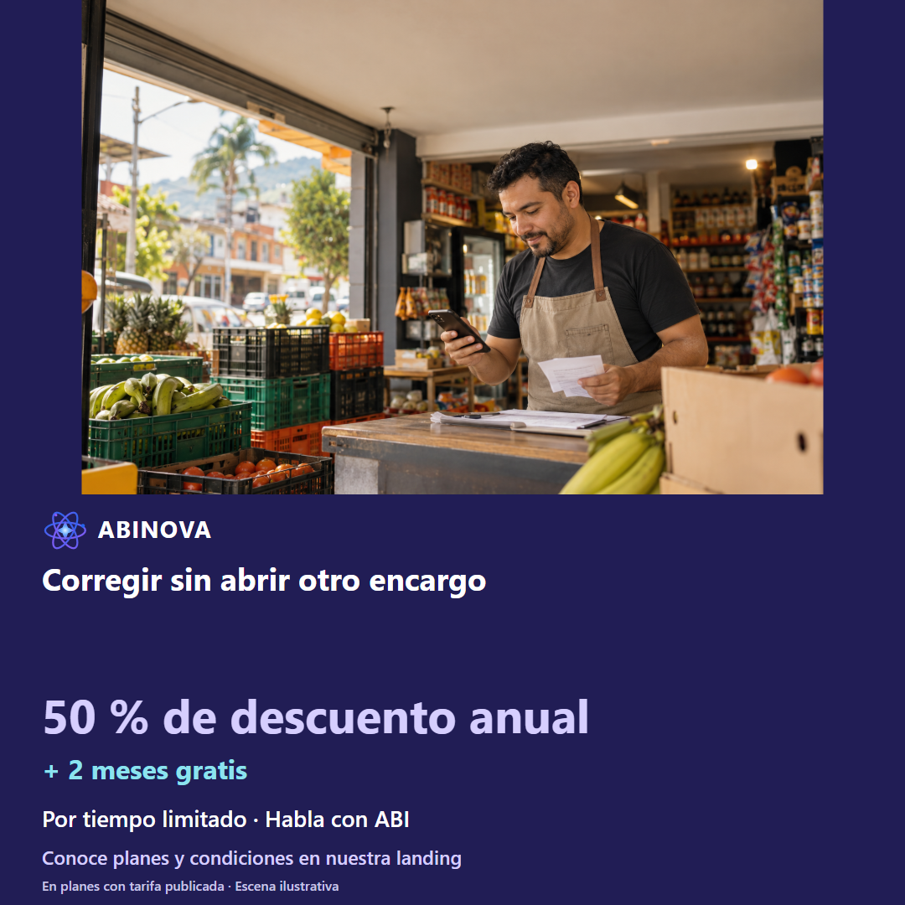

# Tienda en crecimiento · facebook

Tres ángulos; copies A/B, guion narrado, storyboard y prompts de animación completos. Escenas ilustrativas, no testimonios ni videos grabados.

## Imágenes sugeridas locales

<!-- Fuente consolidada: 01-tienda-crecimiento-a1.md -->

# Tienda en crecimiento · Facebook · Ángulo 1: Delegar con límites claros

[Fotografía original](../../recursos/originales/02.png). Escena ilustrativa, no testimonio.

## Copy A · dolor

¿Qué necesita hacer el vendedor y qué debe reservar el administrador? El nuevo vendedor pide la clave del administrador para registrar un pedido. En este caso, no se separan responsabilidades. Antes de decidir, comprueba lo siguiente: El vendedor revisa pedido y pago; no se le atribuyen compras ni cierres. Preparar, aclarar, corregir, revisar y confirmar una vez con permisos. En ABINOVA puedes trabajar con el asistente operativo por voz sobre la pantalla de tu rol, según configuración y permisos. Si falta un dato o la referencia es ambigua, aclara y revisa. Solicita una demo con acceso de vendedor. Conoce cómo funciona en nuestra página y escríbenos por WhatsApp. Ejemplo hipotético; operación sujeta a confirmación. ABI consulta, prepara y corrige con tus permisos; tú confirmas las operaciones. Usa créditos contratados con conexión asignada por el operador, tu propia API o un modelo local opcional según hardware y configuración. La base es 1.000 tokens por crédito, ponderados por modelo; se reserva el consumo y se concilia con el uso registrado. No equivale a mensajes ni es ilimitado. Tu API y el modo local no consumen ese cupo; el consumo de tu API corresponde a tu proveedor. ABINOVA: 50 % de descuento anual en planes con tarifa publicada + 2 meses gratis. Por tiempo limitado. Conoce las condiciones en la landing y habla con ABI.

## Copy B · solución

Así se revisa: delegar con límites claros. El vendedor confirma una operación permitida con su propio acceso. En este caso, no se separan responsabilidades. Antes de decidir, comprueba lo siguiente: El vendedor revisa pedido y pago; no se le atribuyen compras ni cierres. Preparar, aclarar, corregir, revisar y confirmar una vez con permisos. En ABINOVA puedes trabajar con el asistente operativo por voz sobre la pantalla de tu rol, según configuración y permisos. Si falta un dato o la referencia es ambigua, aclara y revisa. Solicita una demo con acceso de vendedor. Conoce cómo funciona en nuestra página y escríbenos por WhatsApp. Ejemplo hipotético; operación sujeta a confirmación. ABI consulta, prepara y corrige con tus permisos; tú confirmas las operaciones. Usa créditos contratados con conexión asignada por el operador, tu propia API o un modelo local opcional según hardware y configuración. La base es 1.000 tokens por crédito, ponderados por modelo; se reserva el consumo y se concilia con el uso registrado. No equivale a mensajes ni es ilimitado. Tu API y el modo local no consumen ese cupo; el consumo de tu API corresponde a tu proveedor. ABINOVA: 50 % de descuento anual en planes con tarifa publicada + 2 meses gratis. Por tiempo limitado. Conoce las condiciones en la landing y habla con ABI.

[STORYBOARD](#angulo-1-storyboard) · [PROMPTANIMACION](#angulo-1-prompt)

Verificar productos y cliente en catálogo QA. Crédito exige cliente registrado; ocasional solo efectivo/billetera. No inventar referencias ni ejecutar sobre negocio.

Asistente de voz/chat configurado; catálogo y referencias existentes; permisos de la sesión. Revisar y aclarar antes de confirmar. La interpretación puede requerir correcciones. No se garantiza entender toda instrucción.

---

<!-- Fuente consolidada: 01-tienda-crecimiento-a1-STORYBOARD.md -->

# Tienda en crecimiento · Facebook · Ángulo 1: Delegar con límites claros

[Fotografía original](../../recursos/originales/02.png). Escena ilustrativa, no testimonio.

## Enfoque A · 50 s

### Escena 1 · 0–5 s

- Cámara: Plano medio del responsable; corte a pantalla legible, ritmo pausado
- Composición: El nuevo vendedor pide la clave del administrador para registrar un pedido.
- Narración: «¿Qué necesita hacer el vendedor y qué debe reservar el administrador?»
- Subtítulo: «¿Qué necesita hacer el vendedor y qué debe reservar el administrador?»
- Evidencia: Editorial; no ejecución grabada.

### Escena 2 · 5–14 s

- Cámara: Plano cenital con esquema de proceso
- Composición: ¿Qué necesita hacer el vendedor y qué debe reservar el administrador?
- Narración: «La causa propuesta: no se separan responsabilidades. ABI consulta, prepara y corrige con tus permisos; tú confirmas las operaciones.»
- Subtítulo: «Todos usan el acceso del dueño»
- Evidencia: Editorial; no ejecución grabada.

### Escena 3 · 14–26 s

- Cámara: Captura fija con acercamiento suave al campo; mantener legible la referencia
- Composición: Propuesta: dictar en la pantalla existente con el rol indicado; chat administrador no demuestra este acceso. Falta toma real de voz.
- Narración: «Prepara para cliente ocasional tres cuadernos, efectivo y para preparar.»
- Subtítulo: «Prepara por voz en tu pantalla»
- Evidencia: Captura contextual disponible; acción específica propuesta por grabar; no ejecución grabada.

### Escena 4 · 26–36 s

- Cámara: Captura fija con acercamiento suave al campo; mantener legible la referencia
- Composición: Propuesta por grabar: corrección y nueva revisión; resaltar el cambio en explicación editorial fuera de la UI.
- Narración: «Conserva tres cuadernos; cambia a billetera.»
- Subtítulo: «Corrige y revisa»
- Evidencia: Captura contextual disponible; acción específica propuesta por grabar; no ejecución grabada.

### Escena 5 · 36–44 s

- Cámara: Captura fija con acercamiento suave al campo; mantener legible la referencia
- Composición: Propuesta por grabar: revisión completa y confirmación. No representar guardado con las capturas actuales.
- Narración: «Comprueba cliente o condición ocasional, referencias, unidades y pago. Confirma una sola vez cuando esté completo.»
- Subtítulo: «Solo confirmar con datos completos»
- Evidencia: Captura contextual disponible; acción específica propuesta por grabar; no ejecución grabada.

### Escena 6 · 44–50 s

- Cámara: Captura fija con acercamiento suave al campo; mantener legible la referencia
- Composición: Pantalla de cierre tipográfica, nombre ABINOVA y CTA sin precios ni planes.
- Narración: «Solicita una demo con acceso de vendedor. Conoce el beneficio anual de ABINOVA.»
- Subtítulo: «50 % de descuento anual + 2 meses gratis»
- Evidencia: Editorial; no ejecución grabada.

## Enfoque B · 54 s

### Escena 1 · 0–5 s

- Cámara: Plano medio del responsable; corte a pantalla legible, ritmo pausado
- Composición: Vista previa editorial del resultado objetivo, rotulada ejemplo hipotético; la ejecución no está grabada.
- Narración: «Así se revisa: delegar con límites claros.»
- Subtítulo: «Así se revisa: delegar con límites claros.»
- Evidencia: Editorial; no ejecución grabada.

### Escena 2 · 5–18 s

- Cámara: Plano cenital con esquema de proceso
- Composición: Dos tarjetas de rol con pedido habilitado y ajuste administrativo reservado.
- Narración: «La revisión permite comprobar: El vendedor revisa pedido y pago; no se le atribuyen compras ni cierres. ABI consulta, prepara y corrige con tus permisos; tú confirmas las operaciones.»
- Subtítulo: «Delegar con límites claros»
- Evidencia: Editorial; no ejecución grabada.

### Escena 3 · 18–30 s

- Cámara: Captura fija con acercamiento suave al campo; mantener legible la referencia
- Composición: Propuesta: dictar en la pantalla existente con el rol indicado; chat administrador no demuestra este acceso. Falta toma real de voz.
- Narración: «Prepara para cliente ocasional tres cuadernos, efectivo y para preparar.»
- Subtítulo: «Prepara por voz en tu pantalla»
- Evidencia: Captura contextual disponible; acción específica propuesta por grabar; no ejecución grabada.

### Escena 4 · 30–40 s

- Cámara: Captura fija con acercamiento suave al campo; mantener legible la referencia
- Composición: Propuesta por grabar: corrección y nueva revisión; resaltar el cambio en explicación editorial fuera de la UI.
- Narración: «Conserva tres cuadernos; cambia a billetera.»
- Subtítulo: «Corrige y revisa»
- Evidencia: Captura contextual disponible; acción específica propuesta por grabar; no ejecución grabada.

### Escena 5 · 40–48 s

- Cámara: Captura fija con acercamiento suave al campo; mantener legible la referencia
- Composición: Propuesta por grabar: revisión completa y confirmación. No representar guardado con las capturas actuales.
- Narración: «Comprueba cliente o condición ocasional, referencias, unidades y pago. Confirma una sola vez cuando esté completo.»
- Subtítulo: «Solo confirmar con datos completos»
- Evidencia: Captura contextual disponible; acción específica propuesta por grabar; no ejecución grabada.

### Escena 6 · 48–54 s

- Cámara: Captura fija con acercamiento suave al campo; mantener legible la referencia
- Composición: Pantalla de cierre tipográfica, nombre ABINOVA y CTA sin precios ni planes.
- Narración: «Solicita una demo con acceso de vendedor. Conoce el beneficio anual de ABINOVA.»
- Subtítulo: «50 % de descuento anual + 2 meses gratis»
- Evidencia: Editorial; no ejecución grabada.

[Copy](#angulo-1-copy) · [PROMPTANIMACION](#angulo-1-prompt)

---

<!-- Fuente consolidada: 01-tienda-crecimiento-a1-PROMPTANIMACION.md -->

# Tienda en crecimiento · Facebook · Ángulo 1: Delegar con límites claros

[Fotografía original](../../recursos/originales/02.png). Escena ilustrativa, no testimonio.

## Prompt A

Animación vertical 1080×1920, 50 s, español de Colombia. Referencia original: marketing/recursos/originales/02.png. Mantener foto, rostro y manos, sin redibujarlos. Movimiento suave de cámara y subtítulos en banda índigo separada de la foto. No superponer app, textos ni gráficos sobre caras. Sin panel blanco obligatorio ni gradientes. Seguir los seis tiempos del STORYBOARD A. No inventar interfaz, guardados ni funciones.  Asistente de voz/chat configurado; catálogo y referencias existentes; permisos de la sesión. Revisar y aclarar antes de confirmar. La interpretación puede requerir correcciones. No se garantiza entender toda instrucción. A/B son alternativas textuales, no exportaciones duplicadas. Apertura: ¿Qué necesita hacer el vendedor y qué debe reservar el administrador? CTA: Solicita una demo con acceso de vendedor. Escena hipotética; sin precios ni planes. Marca ABINOVA, logo estático nuevo, paleta azul índigo #4E4CDB y violeta #9E8BFF. ABI es un ser nebular 2D: enciende sus estrellas al escuchar y su corazón al responder. No superponerlo sobre rostros. Cierre: «50 % de descuento anual + 2 meses gratis · Por tiempo limitado». No mostrar importes. Empresarial: proyecto a medida; dos meses adicionales por acuerdo anual. Resaltar la labor de ABI: ABI consulta, prepara y corrige con tus permisos; tú confirmas las operaciones. No presentar la FAQ pública como agente conectado. No atribuir un SaaS multiempresa compartido en producción ni automatizaciones especializadas ya instaladas. Créditos: base de 1.000 tokens ponderados por modelo, reserva y conciliación; requiere conexión asignada por el operador. API propia y modo local no consumen el cupo incluido. No prometer mensajes ilimitados ni rendimiento local en vivo sin validar hardware.

## Prompt B

Animación vertical 1080×1920, 54 s, español de Colombia. Referencia original: marketing/recursos/originales/02.png. Mantener foto, rostro y manos, sin redibujarlos. Movimiento suave de cámara y subtítulos en banda índigo separada de la foto. No superponer app, textos ni gráficos sobre caras. Sin panel blanco obligatorio ni gradientes. Seguir los seis tiempos del STORYBOARD B. No inventar interfaz, guardados ni funciones.  Asistente de voz/chat configurado; catálogo y referencias existentes; permisos de la sesión. Revisar y aclarar antes de confirmar. La interpretación puede requerir correcciones. No se garantiza entender toda instrucción. A/B son alternativas textuales, no exportaciones duplicadas. Apertura: Así se revisa: delegar con límites claros. CTA: Solicita una demo con acceso de vendedor. Escena hipotética; sin precios ni planes. Marca ABINOVA, logo estático nuevo, paleta azul índigo #4E4CDB y violeta #9E8BFF. ABI es un ser nebular 2D: enciende sus estrellas al escuchar y su corazón al responder. No superponerlo sobre rostros. Cierre: «50 % de descuento anual + 2 meses gratis · Por tiempo limitado». No mostrar importes. Empresarial: proyecto a medida; dos meses adicionales por acuerdo anual. Resaltar la labor de ABI: ABI consulta, prepara y corrige con tus permisos; tú confirmas las operaciones. No presentar la FAQ pública como agente conectado. No atribuir un SaaS multiempresa compartido en producción ni automatizaciones especializadas ya instaladas. Créditos: base de 1.000 tokens ponderados por modelo, reserva y conciliación; requiere conexión asignada por el operador. API propia y modo local no consumen el cupo incluido. No prometer mensajes ilimitados ni rendimiento local en vivo sin validar hardware.

[Copy](#angulo-1-copy) · [STORYBOARD](#angulo-1-storyboard)

---

<!-- Fuente consolidada: 02-tienda-crecimiento-a2.md -->

# Tienda en crecimiento · Facebook · Ángulo 2: Corregir sin abrir otro encargo

[Fotografía original](../../recursos/originales/02.png). Escena ilustrativa, no testimonio.

## Copy A · dolor

¿Estás corrigiendo el borrador o creando otro pedido? El cliente cambia una referencia cuando el vendedor aún revisa el pedido. En este caso, se inicia otra venta para cambiar una línea. Antes de decidir, comprueba lo siguiente: Solo hay un borrador, con referencia nueva y pago conservado. Preparar, aclarar, corregir, revisar y confirmar una vez con permisos. En ABINOVA puedes trabajar con el asistente operativo por voz sobre la pantalla de tu rol, según configuración y permisos. Si falta un dato o la referencia es ambigua, aclara y revisa. Pide una demo de correcciones consecutivas. Conoce cómo funciona en nuestra página y escríbenos por WhatsApp. Ejemplo hipotético; operación sujeta a confirmación. ABI consulta, prepara y corrige con tus permisos; tú confirmas las operaciones. Usa créditos contratados con conexión asignada por el operador, tu propia API o un modelo local opcional según hardware y configuración. La base es 1.000 tokens por crédito, ponderados por modelo; se reserva el consumo y se concilia con el uso registrado. No equivale a mensajes ni es ilimitado. Tu API y el modo local no consumen ese cupo; el consumo de tu API corresponde a tu proveedor. ABINOVA: 50 % de descuento anual en planes con tarifa publicada + 2 meses gratis. Por tiempo limitado. Conoce las condiciones en la landing y habla con ABI.

## Copy B · solución

Así se revisa: corregir sin abrir otro encargo. Se confirma una única revisión del encargo corregido. En este caso, se inicia otra venta para cambiar una línea. Antes de decidir, comprueba lo siguiente: Solo hay un borrador, con referencia nueva y pago conservado. Preparar, aclarar, corregir, revisar y confirmar una vez con permisos. En ABINOVA puedes trabajar con el asistente operativo por voz sobre la pantalla de tu rol, según configuración y permisos. Si falta un dato o la referencia es ambigua, aclara y revisa. Pide una demo de correcciones consecutivas. Conoce cómo funciona en nuestra página y escríbenos por WhatsApp. Ejemplo hipotético; operación sujeta a confirmación. ABI consulta, prepara y corrige con tus permisos; tú confirmas las operaciones. Usa créditos contratados con conexión asignada por el operador, tu propia API o un modelo local opcional según hardware y configuración. La base es 1.000 tokens por crédito, ponderados por modelo; se reserva el consumo y se concilia con el uso registrado. No equivale a mensajes ni es ilimitado. Tu API y el modo local no consumen ese cupo; el consumo de tu API corresponde a tu proveedor. ABINOVA: 50 % de descuento anual en planes con tarifa publicada + 2 meses gratis. Por tiempo limitado. Conoce las condiciones en la landing y habla con ABI.

[STORYBOARD](#angulo-2-storyboard) · [PROMPTANIMACION](#angulo-2-prompt)

Verificar productos y cliente en catálogo QA. Crédito exige cliente registrado; ocasional solo efectivo/billetera. No inventar referencias ni ejecutar sobre negocio.

Asistente de voz/chat configurado; catálogo y referencias existentes; permisos de la sesión. Revisar y aclarar antes de confirmar. La interpretación puede requerir correcciones. No se garantiza entender toda instrucción.

---

<!-- Fuente consolidada: 02-tienda-crecimiento-a2-STORYBOARD.md -->

# Tienda en crecimiento · Facebook · Ángulo 2: Corregir sin abrir otro encargo

[Fotografía original](../../recursos/originales/02.png). Escena ilustrativa, no testimonio.

## Enfoque A · 51 s

### Escena 1 · 0–5 s

- Cámara: Plano medio del responsable; corte a pantalla legible, ritmo pausado
- Composición: El cliente cambia una referencia cuando el vendedor aún revisa el pedido.
- Narración: «¿Estás corrigiendo el borrador o creando otro pedido?»
- Subtítulo: «¿Estás corrigiendo el borrador o creando otro pedido?»
- Evidencia: Editorial; no ejecución grabada.

### Escena 2 · 5–15 s

- Cámara: Plano cenital con esquema de proceso
- Composición: ¿Estás corrigiendo el borrador o creando otro pedido?
- Narración: «La causa propuesta: se inicia otra venta para cambiar una línea. ABI consulta, prepara y corrige con tus permisos; tú confirmas las operaciones.»
- Subtítulo: «Pedidos repetidos al corregir»
- Evidencia: Editorial; no ejecución grabada.

### Escena 3 · 15–27 s

- Cámara: Captura fija con acercamiento suave al campo; mantener legible la referencia
- Composición: Propuesta: dictar en la pantalla existente con el rol indicado; chat administrador no demuestra este acceso. Falta toma real de voz.
- Narración: «Prepara para cliente ocasional dos cuadernos rayados, billetera y para preparar.»
- Subtítulo: «Prepara por voz en tu pantalla»
- Evidencia: Captura contextual disponible; acción específica propuesta por grabar; no ejecución grabada.

### Escena 4 · 27–37 s

- Cámara: Captura fija con acercamiento suave al campo; mantener legible la referencia
- Composición: Propuesta por grabar: corrección y nueva revisión; resaltar el cambio en explicación editorial fuera de la UI.
- Narración: «Reemplaza por cuaderno cuadriculado y conserva dos unidades y billetera.»
- Subtítulo: «Corrige y revisa»
- Evidencia: Captura contextual disponible; acción específica propuesta por grabar; no ejecución grabada.

### Escena 5 · 37–45 s

- Cámara: Captura fija con acercamiento suave al campo; mantener legible la referencia
- Composición: Propuesta por grabar: revisión completa y confirmación. No representar guardado con las capturas actuales.
- Narración: «Comprueba cliente o condición ocasional, referencias, unidades y pago. Confirma una sola vez cuando esté completo.»
- Subtítulo: «Solo confirmar con datos completos»
- Evidencia: Captura contextual disponible; acción específica propuesta por grabar; no ejecución grabada.

### Escena 6 · 45–51 s

- Cámara: Captura fija con acercamiento suave al campo; mantener legible la referencia
- Composición: Pantalla de cierre tipográfica, nombre ABINOVA y CTA sin precios ni planes.
- Narración: «Pide una demo de correcciones consecutivas. Conoce el beneficio anual de ABINOVA.»
- Subtítulo: «50 % de descuento anual + 2 meses gratis»
- Evidencia: Editorial; no ejecución grabada.

## Enfoque B · 53 s

### Escena 1 · 0–5 s

- Cámara: Plano medio del responsable; corte a pantalla legible, ritmo pausado
- Composición: Vista previa editorial del resultado objetivo, rotulada ejemplo hipotético; la ejecución no está grabada.
- Narración: «Así se revisa: corregir sin abrir otro encargo.»
- Subtítulo: «Así se revisa: corregir sin abrir otro encargo.»
- Evidencia: Editorial; no ejecución grabada.

### Escena 2 · 5–17 s

- Cámara: Plano cenital con esquema de proceso
- Composición: Una tarjeta permanece; cambia la referencia y se resaltan los campos conservados.
- Narración: «La revisión permite comprobar: Solo hay un borrador, con referencia nueva y pago conservado. ABI consulta, prepara y corrige con tus permisos; tú confirmas las operaciones.»
- Subtítulo: «Corregir sin abrir otro encargo»
- Evidencia: Editorial; no ejecución grabada.

### Escena 3 · 17–29 s

- Cámara: Captura fija con acercamiento suave al campo; mantener legible la referencia
- Composición: Propuesta: dictar en la pantalla existente con el rol indicado; chat administrador no demuestra este acceso. Falta toma real de voz.
- Narración: «Prepara para cliente ocasional dos cuadernos rayados, billetera y para preparar.»
- Subtítulo: «Prepara por voz en tu pantalla»
- Evidencia: Captura contextual disponible; acción específica propuesta por grabar; no ejecución grabada.

### Escena 4 · 29–39 s

- Cámara: Captura fija con acercamiento suave al campo; mantener legible la referencia
- Composición: Propuesta por grabar: corrección y nueva revisión; resaltar el cambio en explicación editorial fuera de la UI.
- Narración: «Reemplaza por cuaderno cuadriculado y conserva dos unidades y billetera.»
- Subtítulo: «Corrige y revisa»
- Evidencia: Captura contextual disponible; acción específica propuesta por grabar; no ejecución grabada.

### Escena 5 · 39–47 s

- Cámara: Captura fija con acercamiento suave al campo; mantener legible la referencia
- Composición: Propuesta por grabar: revisión completa y confirmación. No representar guardado con las capturas actuales.
- Narración: «Comprueba cliente o condición ocasional, referencias, unidades y pago. Confirma una sola vez cuando esté completo.»
- Subtítulo: «Solo confirmar con datos completos»
- Evidencia: Captura contextual disponible; acción específica propuesta por grabar; no ejecución grabada.

### Escena 6 · 47–53 s

- Cámara: Captura fija con acercamiento suave al campo; mantener legible la referencia
- Composición: Pantalla de cierre tipográfica, nombre ABINOVA y CTA sin precios ni planes.
- Narración: «Pide una demo de correcciones consecutivas. Conoce el beneficio anual de ABINOVA.»
- Subtítulo: «50 % de descuento anual + 2 meses gratis»
- Evidencia: Editorial; no ejecución grabada.

[Copy](#angulo-2-copy) · [PROMPTANIMACION](#angulo-2-prompt)

---

<!-- Fuente consolidada: 02-tienda-crecimiento-a2-PROMPTANIMACION.md -->

# Tienda en crecimiento · Facebook · Ángulo 2: Corregir sin abrir otro encargo

[Fotografía original](../../recursos/originales/02.png). Escena ilustrativa, no testimonio.

## Prompt A

Animación vertical 1080×1920, 51 s, español de Colombia. Referencia original: marketing/recursos/originales/02.png. Mantener foto, rostro y manos, sin redibujarlos. Movimiento suave de cámara y subtítulos en banda índigo separada de la foto. No superponer app, textos ni gráficos sobre caras. Sin panel blanco obligatorio ni gradientes. Seguir los seis tiempos del STORYBOARD A. No inventar interfaz, guardados ni funciones.  Asistente de voz/chat configurado; catálogo y referencias existentes; permisos de la sesión. Revisar y aclarar antes de confirmar. La interpretación puede requerir correcciones. No se garantiza entender toda instrucción. A/B son alternativas textuales, no exportaciones duplicadas. Apertura: ¿Estás corrigiendo el borrador o creando otro pedido? CTA: Pide una demo de correcciones consecutivas. Escena hipotética; sin precios ni planes. Marca ABINOVA, logo estático nuevo, paleta azul índigo #4E4CDB y violeta #9E8BFF. ABI es un ser nebular 2D: enciende sus estrellas al escuchar y su corazón al responder. No superponerlo sobre rostros. Cierre: «50 % de descuento anual + 2 meses gratis · Por tiempo limitado». No mostrar importes. Empresarial: proyecto a medida; dos meses adicionales por acuerdo anual. Resaltar la labor de ABI: ABI consulta, prepara y corrige con tus permisos; tú confirmas las operaciones. No presentar la FAQ pública como agente conectado. No atribuir un SaaS multiempresa compartido en producción ni automatizaciones especializadas ya instaladas. Créditos: base de 1.000 tokens ponderados por modelo, reserva y conciliación; requiere conexión asignada por el operador. API propia y modo local no consumen el cupo incluido. No prometer mensajes ilimitados ni rendimiento local en vivo sin validar hardware.

## Prompt B

Animación vertical 1080×1920, 53 s, español de Colombia. Referencia original: marketing/recursos/originales/02.png. Mantener foto, rostro y manos, sin redibujarlos. Movimiento suave de cámara y subtítulos en banda índigo separada de la foto. No superponer app, textos ni gráficos sobre caras. Sin panel blanco obligatorio ni gradientes. Seguir los seis tiempos del STORYBOARD B. No inventar interfaz, guardados ni funciones.  Asistente de voz/chat configurado; catálogo y referencias existentes; permisos de la sesión. Revisar y aclarar antes de confirmar. La interpretación puede requerir correcciones. No se garantiza entender toda instrucción. A/B son alternativas textuales, no exportaciones duplicadas. Apertura: Así se revisa: corregir sin abrir otro encargo. CTA: Pide una demo de correcciones consecutivas. Escena hipotética; sin precios ni planes. Marca ABINOVA, logo estático nuevo, paleta azul índigo #4E4CDB y violeta #9E8BFF. ABI es un ser nebular 2D: enciende sus estrellas al escuchar y su corazón al responder. No superponerlo sobre rostros. Cierre: «50 % de descuento anual + 2 meses gratis · Por tiempo limitado». No mostrar importes. Empresarial: proyecto a medida; dos meses adicionales por acuerdo anual. Resaltar la labor de ABI: ABI consulta, prepara y corrige con tus permisos; tú confirmas las operaciones. No presentar la FAQ pública como agente conectado. No atribuir un SaaS multiempresa compartido en producción ni automatizaciones especializadas ya instaladas. Créditos: base de 1.000 tokens ponderados por modelo, reserva y conciliación; requiere conexión asignada por el operador. API propia y modo local no consumen el cupo incluido. No prometer mensajes ilimitados ni rendimiento local en vivo sin validar hardware.

[Copy](#angulo-2-copy) · [STORYBOARD](#angulo-2-storyboard)

---

<!-- Fuente consolidada: 03-tienda-crecimiento-a3.md -->

# Tienda en crecimiento · Facebook · Ángulo 3: El relevo ve qué falta

[Fotografía original](../../recursos/originales/02.png). Escena ilustrativa, no testimonio.

## Copy A · dolor

¿Tu relevo distingue lo pendiente de lo entregado? El siguiente vendedor encuentra una bolsa sin saber a qué pedido corresponde. En este caso, no existe estado común. Antes de decidir, comprueba lo siguiente: Se revisa el pedido identificado y su transición permitida; no se cancela un entregado. Preparar, aclarar, corregir, revisar y confirmar una vez con permisos. En ABINOVA puedes trabajar con el asistente operativo por voz sobre la pantalla de tu rol, según configuración y permisos. Si falta un dato o la referencia es ambigua, aclara y revisa. Solicita el recorrido de un pedido pendiente hasta su entrega. Conoce cómo funciona en nuestra página y escríbenos por WhatsApp. Ejemplo hipotético; operación sujeta a confirmación. ABI identifica el pedido y propone el cambio de estado para tu revisión y confirmación. Usa créditos contratados con conexión asignada por el operador, tu propia API o un modelo local opcional según hardware y configuración. La base es 1.000 tokens por crédito, ponderados por modelo; se reserva el consumo y se concilia con el uso registrado. No equivale a mensajes ni es ilimitado. Tu API y el modo local no consumen ese cupo; el consumo de tu API corresponde a tu proveedor. ABINOVA: 50 % de descuento anual en planes con tarifa publicada + 2 meses gratis. Por tiempo limitado. Conoce las condiciones en la landing y habla con ABI.

## Copy B · solución

Así se revisa: el relevo ve qué falta. El estado confirmado puede consultarse en el detalle del pedido. En este caso, no existe estado común. Antes de decidir, comprueba lo siguiente: Se revisa el pedido identificado y su transición permitida; no se cancela un entregado. Preparar, aclarar, corregir, revisar y confirmar una vez con permisos. En ABINOVA puedes trabajar con el asistente operativo por voz sobre la pantalla de tu rol, según configuración y permisos. Si falta un dato o la referencia es ambigua, aclara y revisa. Solicita el recorrido de un pedido pendiente hasta su entrega. Conoce cómo funciona en nuestra página y escríbenos por WhatsApp. Ejemplo hipotético; operación sujeta a confirmación. ABI identifica el pedido y propone el cambio de estado para tu revisión y confirmación. Usa créditos contratados con conexión asignada por el operador, tu propia API o un modelo local opcional según hardware y configuración. La base es 1.000 tokens por crédito, ponderados por modelo; se reserva el consumo y se concilia con el uso registrado. No equivale a mensajes ni es ilimitado. Tu API y el modo local no consumen ese cupo; el consumo de tu API corresponde a tu proveedor. ABINOVA: 50 % de descuento anual en planes con tarifa publicada + 2 meses gratis. Por tiempo limitado. Conoce las condiciones en la landing y habla con ABI.

[STORYBOARD](#angulo-3-storyboard) · [PROMPTANIMACION](#angulo-3-prompt)

La referencia DEMO-001 es ficticia. Sustituir por un pedido QA existente y escoger la transición real permitida; no usar un entregado para cancelar.

Asistente de voz/chat configurado; catálogo y referencias existentes; permisos de la sesión. Revisar y aclarar antes de confirmar. La interpretación puede requerir correcciones. No se garantiza entender toda instrucción.

---

<!-- Fuente consolidada: 03-tienda-crecimiento-a3-STORYBOARD.md -->

# Tienda en crecimiento · Facebook · Ángulo 3: El relevo ve qué falta

[Fotografía original](../../recursos/originales/02.png). Escena ilustrativa, no testimonio.

## Enfoque A · 52 s

### Escena 1 · 0–5 s

- Cámara: Plano medio del responsable; corte a pantalla legible, ritmo pausado
- Composición: El siguiente vendedor encuentra una bolsa sin saber a qué pedido corresponde.
- Narración: «¿Tu relevo distingue lo pendiente de lo entregado?»
- Subtítulo: «¿Tu relevo distingue lo pendiente de lo entregado?»
- Evidencia: Editorial; no ejecución grabada.

### Escena 2 · 5–15 s

- Cámara: Plano cenital con esquema de proceso
- Composición: ¿Tu relevo distingue lo pendiente de lo entregado?
- Narración: «La causa propuesta: no existe estado común. ABI identifica el pedido y propone el cambio de estado para tu revisión y confirmación.»
- Subtítulo: «Pendientes perdidos entre conversaciones»
- Evidencia: Editorial; no ejecución grabada.

### Escena 3 · 15–27 s

- Cámara: Captura fija con acercamiento suave al campo; mantener legible la referencia
- Composición: Propuesta: dictar en la pantalla existente con el rol indicado; chat administrador no demuestra este acceso. Falta toma real de voz.
- Narración: «Prepara el cambio del pedido DEMO-001 al estado que corresponde a su entrega.»
- Subtítulo: «Prepara por voz en tu pantalla»
- Evidencia: Captura contextual disponible; acción específica propuesta por grabar; no ejecución grabada.

### Escena 4 · 27–37 s

- Cámara: Captura fija con acercamiento suave al campo; mantener legible la referencia
- Composición: Propuesta por grabar: corrección y nueva revisión; resaltar el cambio en explicación editorial fuera de la UI.
- Narración: «Aclara la referencia exacta y selecciona el estado permitido en la revisión.»
- Subtítulo: «Corrige y revisa»
- Evidencia: Captura contextual disponible; acción específica propuesta por grabar; no ejecución grabada.

### Escena 5 · 37–45 s

- Cámara: Captura fija con acercamiento suave al campo; mantener legible la referencia
- Composición: Propuesta por grabar: revisión completa y confirmación. No representar guardado con las capturas actuales.
- Narración: «Comprueba cliente o condición ocasional, referencias, unidades y pago. Confirma una sola vez cuando esté completo.»
- Subtítulo: «Solo confirmar con datos completos»
- Evidencia: Captura contextual disponible; acción específica propuesta por grabar; no ejecución grabada.

### Escena 6 · 45–52 s

- Cámara: Captura fija con acercamiento suave al campo; mantener legible la referencia
- Composición: Pantalla de cierre tipográfica, nombre ABINOVA y CTA sin precios ni planes.
- Narración: «Solicita el recorrido de un pedido pendiente hasta su entrega. Conoce el beneficio anual de ABINOVA.»
- Subtítulo: «50 % de descuento anual + 2 meses gratis»
- Evidencia: Editorial; no ejecución grabada.

## Enfoque B · 57 s

### Escena 1 · 0–5 s

- Cámara: Plano medio del responsable; corte a pantalla legible, ritmo pausado
- Composición: Vista previa editorial del resultado objetivo, rotulada ejemplo hipotético; la ejecución no está grabada.
- Narración: «Así se revisa: el relevo ve qué falta.»
- Subtítulo: «Así se revisa: el relevo ve qué falta.»
- Evidencia: Editorial; no ejecución grabada.

### Escena 2 · 5–20 s

- Cámara: Plano cenital con esquema de proceso
- Composición: Detalle del mismo pedido con referencia visible y estado revisado.
- Narración: «La revisión permite comprobar: Se revisa el pedido identificado y su transición permitida; no se cancela un entregado. ABI identifica el pedido y propone el cambio de estado para tu revisión y confirmación.»
- Subtítulo: «El relevo ve qué falta»
- Evidencia: Editorial; no ejecución grabada.

### Escena 3 · 20–32 s

- Cámara: Captura fija con acercamiento suave al campo; mantener legible la referencia
- Composición: Propuesta: dictar en la pantalla existente con el rol indicado; chat administrador no demuestra este acceso. Falta toma real de voz.
- Narración: «Prepara el cambio del pedido DEMO-001 al estado que corresponde a su entrega.»
- Subtítulo: «Prepara por voz en tu pantalla»
- Evidencia: Captura contextual disponible; acción específica propuesta por grabar; no ejecución grabada.

### Escena 4 · 32–42 s

- Cámara: Captura fija con acercamiento suave al campo; mantener legible la referencia
- Composición: Propuesta por grabar: corrección y nueva revisión; resaltar el cambio en explicación editorial fuera de la UI.
- Narración: «Aclara la referencia exacta y selecciona el estado permitido en la revisión.»
- Subtítulo: «Corrige y revisa»
- Evidencia: Captura contextual disponible; acción específica propuesta por grabar; no ejecución grabada.

### Escena 5 · 42–50 s

- Cámara: Captura fija con acercamiento suave al campo; mantener legible la referencia
- Composición: Propuesta por grabar: revisión completa y confirmación. No representar guardado con las capturas actuales.
- Narración: «Comprueba cliente o condición ocasional, referencias, unidades y pago. Confirma una sola vez cuando esté completo.»
- Subtítulo: «Solo confirmar con datos completos»
- Evidencia: Captura contextual disponible; acción específica propuesta por grabar; no ejecución grabada.

### Escena 6 · 50–57 s

- Cámara: Captura fija con acercamiento suave al campo; mantener legible la referencia
- Composición: Pantalla de cierre tipográfica, nombre ABINOVA y CTA sin precios ni planes.
- Narración: «Solicita el recorrido de un pedido pendiente hasta su entrega. Conoce el beneficio anual de ABINOVA.»
- Subtítulo: «50 % de descuento anual + 2 meses gratis»
- Evidencia: Editorial; no ejecución grabada.

[Copy](#angulo-3-copy) · [PROMPTANIMACION](#angulo-3-prompt)

---

<!-- Fuente consolidada: 03-tienda-crecimiento-a3-PROMPTANIMACION.md -->

# Tienda en crecimiento · Facebook · Ángulo 3: El relevo ve qué falta

[Fotografía original](../../recursos/originales/02.png). Escena ilustrativa, no testimonio.

## Prompt A

Animación vertical 1080×1920, 52 s, español de Colombia. Referencia original: marketing/recursos/originales/02.png. Mantener foto, rostro y manos, sin redibujarlos. Movimiento suave de cámara y subtítulos en banda índigo separada de la foto. No superponer app, textos ni gráficos sobre caras. Sin panel blanco obligatorio ni gradientes. Seguir los seis tiempos del STORYBOARD A. No inventar interfaz, guardados ni funciones.  Asistente de voz/chat configurado; catálogo y referencias existentes; permisos de la sesión. Revisar y aclarar antes de confirmar. La interpretación puede requerir correcciones. No se garantiza entender toda instrucción. A/B son alternativas textuales, no exportaciones duplicadas. Apertura: ¿Tu relevo distingue lo pendiente de lo entregado? CTA: Solicita el recorrido de un pedido pendiente hasta su entrega. Escena hipotética; sin precios ni planes. Marca ABINOVA, logo estático nuevo, paleta azul índigo #4E4CDB y violeta #9E8BFF. ABI es un ser nebular 2D: enciende sus estrellas al escuchar y su corazón al responder. No superponerlo sobre rostros. Cierre: «50 % de descuento anual + 2 meses gratis · Por tiempo limitado». No mostrar importes. Empresarial: proyecto a medida; dos meses adicionales por acuerdo anual. Resaltar la labor de ABI: ABI identifica el pedido y propone el cambio de estado para tu revisión y confirmación. No presentar la FAQ pública como agente conectado. No atribuir un SaaS multiempresa compartido en producción ni automatizaciones especializadas ya instaladas. Créditos: base de 1.000 tokens ponderados por modelo, reserva y conciliación; requiere conexión asignada por el operador. API propia y modo local no consumen el cupo incluido. No prometer mensajes ilimitados ni rendimiento local en vivo sin validar hardware.

## Prompt B

Animación vertical 1080×1920, 57 s, español de Colombia. Referencia original: marketing/recursos/originales/02.png. Mantener foto, rostro y manos, sin redibujarlos. Movimiento suave de cámara y subtítulos en banda índigo separada de la foto. No superponer app, textos ni gráficos sobre caras. Sin panel blanco obligatorio ni gradientes. Seguir los seis tiempos del STORYBOARD B. No inventar interfaz, guardados ni funciones.  Asistente de voz/chat configurado; catálogo y referencias existentes; permisos de la sesión. Revisar y aclarar antes de confirmar. La interpretación puede requerir correcciones. No se garantiza entender toda instrucción. A/B son alternativas textuales, no exportaciones duplicadas. Apertura: Así se revisa: el relevo ve qué falta. CTA: Solicita el recorrido de un pedido pendiente hasta su entrega. Escena hipotética; sin precios ni planes. Marca ABINOVA, logo estático nuevo, paleta azul índigo #4E4CDB y violeta #9E8BFF. ABI es un ser nebular 2D: enciende sus estrellas al escuchar y su corazón al responder. No superponerlo sobre rostros. Cierre: «50 % de descuento anual + 2 meses gratis · Por tiempo limitado». No mostrar importes. Empresarial: proyecto a medida; dos meses adicionales por acuerdo anual. Resaltar la labor de ABI: ABI identifica el pedido y propone el cambio de estado para tu revisión y confirmación. No presentar la FAQ pública como agente conectado. No atribuir un SaaS multiempresa compartido en producción ni automatizaciones especializadas ya instaladas. Créditos: base de 1.000 tokens ponderados por modelo, reserva y conciliación; requiere conexión asignada por el operador. API propia y modo local no consumen el cupo incluido. No prometer mensajes ilimitados ni rendimiento local en vivo sin validar hardware.

[Copy](#angulo-3-copy) · [STORYBOARD](#angulo-3-storyboard)

---

