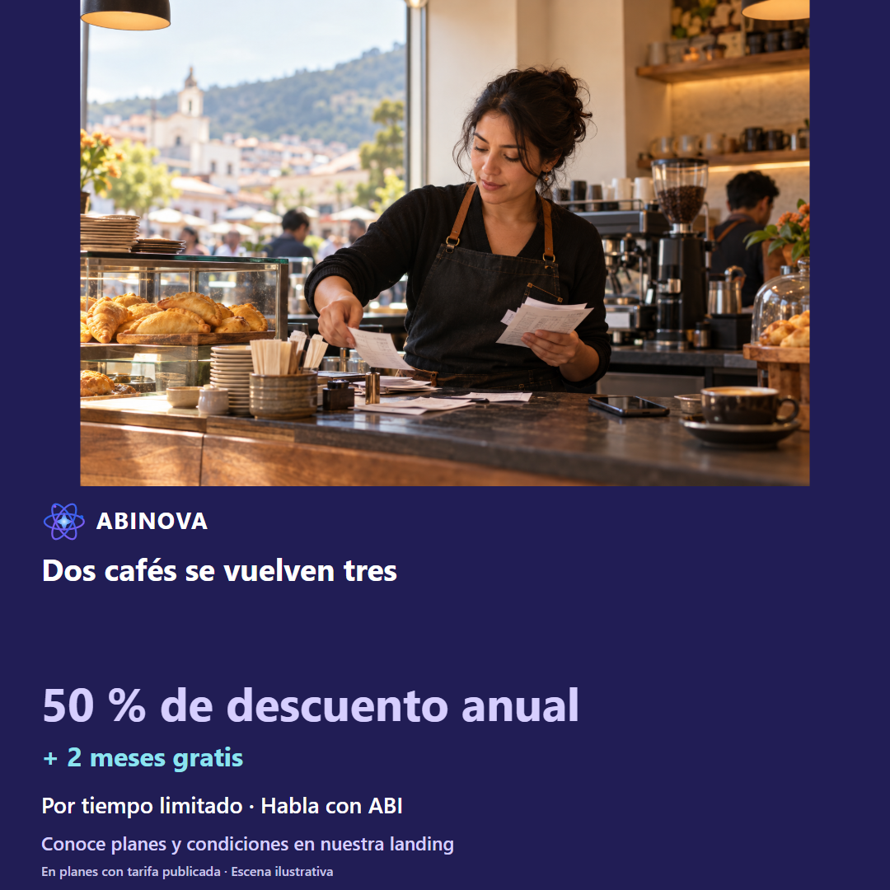
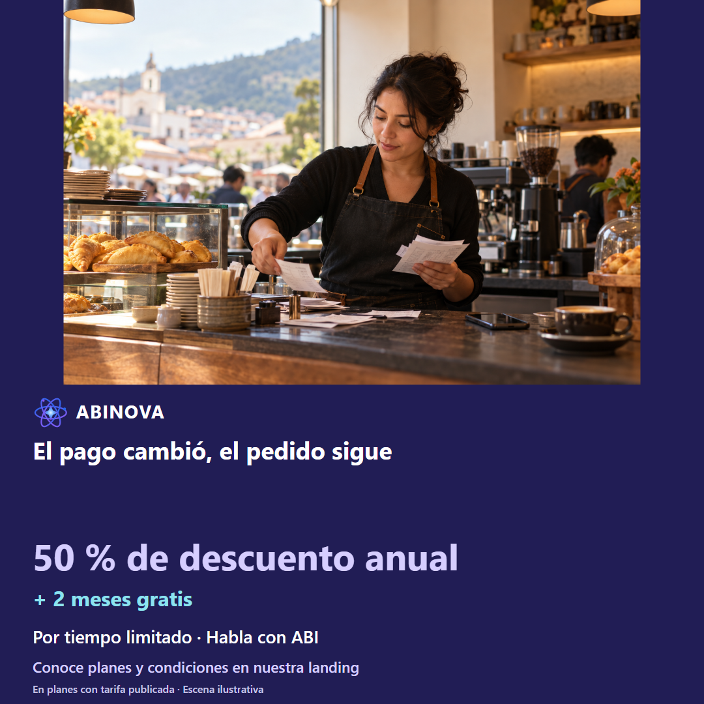
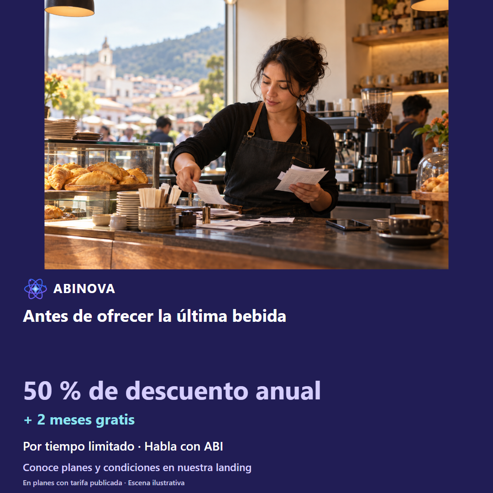

# Cafetería y comidas rápidas · facebook

Tres ángulos; copies A/B, guion narrado, storyboard y prompts de animación completos. Escenas ilustrativas, no testimonios ni videos grabados.

## Imágenes sugeridas locales

<!-- Fuente consolidada: 01-cafeteria-comidas-rapidas-a1.md -->

# Cafetería y comidas rápidas · Facebook · Ángulo 1: Dos cafés se vuelven tres

[Fotografía original](../../recursos/originales/03.png). Escena ilustrativa, no testimonio.

## Copy A · dolor

¿La cantidad final quedó en el pedido o solo en la conversación? Mientras se revisa el pedido el cliente añade otro café. En este caso, el cliente añade una unidad al hablar. Antes de decidir, comprueba lo siguiente: Tres cafés, una arepa y efectivo permanecen en un solo borrador. Preparar, aclarar, corregir, revisar y confirmar una vez con permisos. En ABINOVA puedes trabajar con el asistente operativo por voz sobre la pantalla de tu rol, según configuración y permisos. Si falta un dato o la referencia es ambigua, aclara y revisa. Solicita una demo de atención en mostrador. Conoce cómo funciona en nuestra página y escríbenos por WhatsApp. Ejemplo hipotético; operación sujeta a confirmación. ABI consulta, prepara y corrige con tus permisos; tú confirmas las operaciones. Usa créditos contratados con conexión asignada por el operador, tu propia API o un modelo local opcional según hardware y configuración. La base es 1.000 tokens por crédito, ponderados por modelo; se reserva el consumo y se concilia con el uso registrado. No equivale a mensajes ni es ilimitado. Tu API y el modo local no consumen ese cupo; el consumo de tu API corresponde a tu proveedor. ABINOVA: 50 % de descuento anual en planes con tarifa publicada + 2 meses gratis. Por tiempo limitado. Conoce las condiciones en la landing y habla con ABI.

## Copy B · solución

Así se revisa: dos cafés se vuelven tres. La revisión refleja el pedido final antes de confirmarlo. En este caso, el cliente añade una unidad al hablar. Antes de decidir, comprueba lo siguiente: Tres cafés, una arepa y efectivo permanecen en un solo borrador. Preparar, aclarar, corregir, revisar y confirmar una vez con permisos. En ABINOVA puedes trabajar con el asistente operativo por voz sobre la pantalla de tu rol, según configuración y permisos. Si falta un dato o la referencia es ambigua, aclara y revisa. Solicita una demo de atención en mostrador. Conoce cómo funciona en nuestra página y escríbenos por WhatsApp. Ejemplo hipotético; operación sujeta a confirmación. ABI consulta, prepara y corrige con tus permisos; tú confirmas las operaciones. Usa créditos contratados con conexión asignada por el operador, tu propia API o un modelo local opcional según hardware y configuración. La base es 1.000 tokens por crédito, ponderados por modelo; se reserva el consumo y se concilia con el uso registrado. No equivale a mensajes ni es ilimitado. Tu API y el modo local no consumen ese cupo; el consumo de tu API corresponde a tu proveedor. ABINOVA: 50 % de descuento anual en planes con tarifa publicada + 2 meses gratis. Por tiempo limitado. Conoce las condiciones en la landing y habla con ABI.

[STORYBOARD](#angulo-1-storyboard) · [PROMPTANIMACION](#angulo-1-prompt)

Verificar productos y cliente en catálogo QA. Crédito exige cliente registrado; ocasional solo efectivo/billetera. No inventar referencias ni ejecutar sobre negocio.

Asistente de voz/chat configurado; catálogo y referencias existentes; permisos de la sesión. Revisar y aclarar antes de confirmar. La interpretación puede requerir correcciones. No se garantiza entender toda instrucción.

---

<!-- Fuente consolidada: 01-cafeteria-comidas-rapidas-a1-STORYBOARD.md -->

# Cafetería y comidas rápidas · Facebook · Ángulo 1: Dos cafés se vuelven tres

[Fotografía original](../../recursos/originales/03.png). Escena ilustrativa, no testimonio.

## Enfoque A · 52 s

### Escena 1 · 0–6 s

- Cámara: Plano medio del responsable; corte a pantalla legible, ritmo pausado
- Composición: Mientras se revisa el pedido el cliente añade otro café.
- Narración: «¿La cantidad final quedó en el pedido o solo en la conversación?»
- Subtítulo: «¿La cantidad final quedó en el pedido o solo en la conversación?»
- Evidencia: Editorial; no ejecución grabada.

### Escena 2 · 6–16 s

- Cámara: Plano cenital con esquema de proceso
- Composición: ¿La cantidad final quedó en el pedido o solo en la conversación?
- Narración: «La causa propuesta: el cliente añade una unidad al hablar. ABI consulta, prepara y corrige con tus permisos; tú confirmas las operaciones.»
- Subtítulo: «Cantidad cambiada durante el pedido»
- Evidencia: Editorial; no ejecución grabada.

### Escena 3 · 16–28 s

- Cámara: Captura fija con acercamiento suave al campo; mantener legible la referencia
- Composición: Propuesta: dictar en la pantalla existente con el rol indicado; chat administrador no demuestra este acceso. Falta toma real de voz.
- Narración: «Prepara para cliente ocasional dos cafés y una arepa de queso, efectivo y para preparar.»
- Subtítulo: «Prepara por voz en tu pantalla»
- Evidencia: Captura contextual disponible; acción específica propuesta por grabar; no ejecución grabada.

### Escena 4 · 28–38 s

- Cámara: Captura fija con acercamiento suave al campo; mantener legible la referencia
- Composición: Propuesta por grabar: corrección y nueva revisión; resaltar el cambio en explicación editorial fuera de la UI.
- Narración: «Cambia a tres cafés; conserva la arepa y el pago.»
- Subtítulo: «Corrige y revisa»
- Evidencia: Captura contextual disponible; acción específica propuesta por grabar; no ejecución grabada.

### Escena 5 · 38–46 s

- Cámara: Captura fija con acercamiento suave al campo; mantener legible la referencia
- Composición: Propuesta por grabar: revisión completa y confirmación. No representar guardado con las capturas actuales.
- Narración: «Comprueba cliente o condición ocasional, referencias, unidades y pago. Confirma una sola vez cuando esté completo.»
- Subtítulo: «Solo confirmar con datos completos»
- Evidencia: Captura contextual disponible; acción específica propuesta por grabar; no ejecución grabada.

### Escena 6 · 46–52 s

- Cámara: Captura fija con acercamiento suave al campo; mantener legible la referencia
- Composición: Pantalla de cierre tipográfica, nombre ABINOVA y CTA sin precios ni planes.
- Narración: «Solicita una demo de atención en mostrador. Conoce el beneficio anual de ABINOVA.»
- Subtítulo: «50 % de descuento anual + 2 meses gratis»
- Evidencia: Editorial; no ejecución grabada.

## Enfoque B · 53 s

### Escena 1 · 0–5 s

- Cámara: Plano medio del responsable; corte a pantalla legible, ritmo pausado
- Composición: Vista previa editorial del resultado objetivo, rotulada ejemplo hipotético; la ejecución no está grabada.
- Narración: «Así se revisa: dos cafés se vuelven tres.»
- Subtítulo: «Así se revisa: dos cafés se vuelven tres.»
- Evidencia: Editorial; no ejecución grabada.

### Escena 2 · 5–17 s

- Cámara: Plano cenital con esquema de proceso
- Composición: Contador de unidades pasa de dos a tres sobre la misma revisión.
- Narración: «La revisión permite comprobar: Tres cafés, una arepa y efectivo permanecen en un solo borrador. ABI consulta, prepara y corrige con tus permisos; tú confirmas las operaciones.»
- Subtítulo: «Dos cafés se vuelven tres»
- Evidencia: Editorial; no ejecución grabada.

### Escena 3 · 17–29 s

- Cámara: Captura fija con acercamiento suave al campo; mantener legible la referencia
- Composición: Propuesta: dictar en la pantalla existente con el rol indicado; chat administrador no demuestra este acceso. Falta toma real de voz.
- Narración: «Prepara para cliente ocasional dos cafés y una arepa de queso, efectivo y para preparar.»
- Subtítulo: «Prepara por voz en tu pantalla»
- Evidencia: Captura contextual disponible; acción específica propuesta por grabar; no ejecución grabada.

### Escena 4 · 29–39 s

- Cámara: Captura fija con acercamiento suave al campo; mantener legible la referencia
- Composición: Propuesta por grabar: corrección y nueva revisión; resaltar el cambio en explicación editorial fuera de la UI.
- Narración: «Cambia a tres cafés; conserva la arepa y el pago.»
- Subtítulo: «Corrige y revisa»
- Evidencia: Captura contextual disponible; acción específica propuesta por grabar; no ejecución grabada.

### Escena 5 · 39–47 s

- Cámara: Captura fija con acercamiento suave al campo; mantener legible la referencia
- Composición: Propuesta por grabar: revisión completa y confirmación. No representar guardado con las capturas actuales.
- Narración: «Comprueba cliente o condición ocasional, referencias, unidades y pago. Confirma una sola vez cuando esté completo.»
- Subtítulo: «Solo confirmar con datos completos»
- Evidencia: Captura contextual disponible; acción específica propuesta por grabar; no ejecución grabada.

### Escena 6 · 47–53 s

- Cámara: Captura fija con acercamiento suave al campo; mantener legible la referencia
- Composición: Pantalla de cierre tipográfica, nombre ABINOVA y CTA sin precios ni planes.
- Narración: «Solicita una demo de atención en mostrador. Conoce el beneficio anual de ABINOVA.»
- Subtítulo: «50 % de descuento anual + 2 meses gratis»
- Evidencia: Editorial; no ejecución grabada.

[Copy](#angulo-1-copy) · [PROMPTANIMACION](#angulo-1-prompt)

---

<!-- Fuente consolidada: 01-cafeteria-comidas-rapidas-a1-PROMPTANIMACION.md -->

# Cafetería y comidas rápidas · Facebook · Ángulo 1: Dos cafés se vuelven tres

[Fotografía original](../../recursos/originales/03.png). Escena ilustrativa, no testimonio.

## Prompt A

Animación vertical 1080×1920, 52 s, español de Colombia. Referencia original: marketing/recursos/originales/03.png. Mantener foto, rostro y manos, sin redibujarlos. Movimiento suave de cámara y subtítulos en banda índigo separada de la foto. No superponer app, textos ni gráficos sobre caras. Sin panel blanco obligatorio ni gradientes. Seguir los seis tiempos del STORYBOARD A. No inventar interfaz, guardados ni funciones.  Asistente de voz/chat configurado; catálogo y referencias existentes; permisos de la sesión. Revisar y aclarar antes de confirmar. La interpretación puede requerir correcciones. No se garantiza entender toda instrucción. A/B son alternativas textuales, no exportaciones duplicadas. Apertura: ¿La cantidad final quedó en el pedido o solo en la conversación? CTA: Solicita una demo de atención en mostrador. Escena hipotética; sin precios ni planes. Marca ABINOVA, logo estático nuevo, paleta azul índigo #4E4CDB y violeta #9E8BFF. ABI es un ser nebular 2D: enciende sus estrellas al escuchar y su corazón al responder. No superponerlo sobre rostros. Cierre: «50 % de descuento anual + 2 meses gratis · Por tiempo limitado». No mostrar importes. Empresarial: proyecto a medida; dos meses adicionales por acuerdo anual. Resaltar la labor de ABI: ABI consulta, prepara y corrige con tus permisos; tú confirmas las operaciones. No presentar la FAQ pública como agente conectado. No atribuir un SaaS multiempresa compartido en producción ni automatizaciones especializadas ya instaladas. Créditos: base de 1.000 tokens ponderados por modelo, reserva y conciliación; requiere conexión asignada por el operador. API propia y modo local no consumen el cupo incluido. No prometer mensajes ilimitados ni rendimiento local en vivo sin validar hardware.

## Prompt B

Animación vertical 1080×1920, 53 s, español de Colombia. Referencia original: marketing/recursos/originales/03.png. Mantener foto, rostro y manos, sin redibujarlos. Movimiento suave de cámara y subtítulos en banda índigo separada de la foto. No superponer app, textos ni gráficos sobre caras. Sin panel blanco obligatorio ni gradientes. Seguir los seis tiempos del STORYBOARD B. No inventar interfaz, guardados ni funciones.  Asistente de voz/chat configurado; catálogo y referencias existentes; permisos de la sesión. Revisar y aclarar antes de confirmar. La interpretación puede requerir correcciones. No se garantiza entender toda instrucción. A/B son alternativas textuales, no exportaciones duplicadas. Apertura: Así se revisa: dos cafés se vuelven tres. CTA: Solicita una demo de atención en mostrador. Escena hipotética; sin precios ni planes. Marca ABINOVA, logo estático nuevo, paleta azul índigo #4E4CDB y violeta #9E8BFF. ABI es un ser nebular 2D: enciende sus estrellas al escuchar y su corazón al responder. No superponerlo sobre rostros. Cierre: «50 % de descuento anual + 2 meses gratis · Por tiempo limitado». No mostrar importes. Empresarial: proyecto a medida; dos meses adicionales por acuerdo anual. Resaltar la labor de ABI: ABI consulta, prepara y corrige con tus permisos; tú confirmas las operaciones. No presentar la FAQ pública como agente conectado. No atribuir un SaaS multiempresa compartido en producción ni automatizaciones especializadas ya instaladas. Créditos: base de 1.000 tokens ponderados por modelo, reserva y conciliación; requiere conexión asignada por el operador. API propia y modo local no consumen el cupo incluido. No prometer mensajes ilimitados ni rendimiento local en vivo sin validar hardware.

[Copy](#angulo-1-copy) · [STORYBOARD](#angulo-1-storyboard)

---

<!-- Fuente consolidada: 02-cafeteria-comidas-rapidas-a2.md -->

# Cafetería y comidas rápidas · Facebook · Ángulo 2: El pago cambió, el pedido sigue

[Fotografía original](../../recursos/originales/03.png). Escena ilustrativa, no testimonio.

## Copy A · dolor

¿Qué dato revisas antes de cerrar el pedido? El cliente elige billetera después de pedir en efectivo. En este caso, se cobra mientras se atiende otro pedido. Antes de decidir, comprueba lo siguiente: La revisión conserva tres unidades de dos referencias y cambia el medio. Preparar, aclarar, corregir, revisar y confirmar una vez con permisos. En ABINOVA puedes trabajar con el asistente operativo por voz sobre la pantalla de tu rol, según configuración y permisos. Si falta un dato o la referencia es ambigua, aclara y revisa. Pide una demo corrigiendo el medio de pago. Conoce cómo funciona en nuestra página y escríbenos por WhatsApp. Ejemplo hipotético; operación sujeta a confirmación. ABI consulta, prepara y corrige con tus permisos; tú confirmas las operaciones. Usa créditos contratados con conexión asignada por el operador, tu propia API o un modelo local opcional según hardware y configuración. La base es 1.000 tokens por crédito, ponderados por modelo; se reserva el consumo y se concilia con el uso registrado. No equivale a mensajes ni es ilimitado. Tu API y el modo local no consumen ese cupo; el consumo de tu API corresponde a tu proveedor. ABINOVA: 50 % de descuento anual en planes con tarifa publicada + 2 meses gratis. Por tiempo limitado. Conoce las condiciones en la landing y habla con ABI.

## Copy B · solución

Así se revisa: el pago cambió, el pedido sigue. El medio confirmado acompaña la venta registrada. En este caso, se cobra mientras se atiende otro pedido. Antes de decidir, comprueba lo siguiente: La revisión conserva tres unidades de dos referencias y cambia el medio. Preparar, aclarar, corregir, revisar y confirmar una vez con permisos. En ABINOVA puedes trabajar con el asistente operativo por voz sobre la pantalla de tu rol, según configuración y permisos. Si falta un dato o la referencia es ambigua, aclara y revisa. Pide una demo corrigiendo el medio de pago. Conoce cómo funciona en nuestra página y escríbenos por WhatsApp. Ejemplo hipotético; operación sujeta a confirmación. ABI consulta, prepara y corrige con tus permisos; tú confirmas las operaciones. Usa créditos contratados con conexión asignada por el operador, tu propia API o un modelo local opcional según hardware y configuración. La base es 1.000 tokens por crédito, ponderados por modelo; se reserva el consumo y se concilia con el uso registrado. No equivale a mensajes ni es ilimitado. Tu API y el modo local no consumen ese cupo; el consumo de tu API corresponde a tu proveedor. ABINOVA: 50 % de descuento anual en planes con tarifa publicada + 2 meses gratis. Por tiempo limitado. Conoce las condiciones en la landing y habla con ABI.

[STORYBOARD](#angulo-2-storyboard) · [PROMPTANIMACION](#angulo-2-prompt)

Verificar productos y cliente en catálogo QA. Crédito exige cliente registrado; ocasional solo efectivo/billetera. No inventar referencias ni ejecutar sobre negocio.

Asistente de voz/chat configurado; catálogo y referencias existentes; permisos de la sesión. Revisar y aclarar antes de confirmar. La interpretación puede requerir correcciones. No se garantiza entender toda instrucción.

---

<!-- Fuente consolidada: 02-cafeteria-comidas-rapidas-a2-STORYBOARD.md -->

# Cafetería y comidas rápidas · Facebook · Ángulo 2: El pago cambió, el pedido sigue

[Fotografía original](../../recursos/originales/03.png). Escena ilustrativa, no testimonio.

## Enfoque A · 52 s

### Escena 1 · 0–5 s

- Cámara: Plano medio del responsable; corte a pantalla legible, ritmo pausado
- Composición: El cliente elige billetera después de pedir en efectivo.
- Narración: «¿Qué dato revisas antes de cerrar el pedido?»
- Subtítulo: «¿Qué dato revisas antes de cerrar el pedido?»
- Evidencia: Editorial; no ejecución grabada.

### Escena 2 · 5–15 s

- Cámara: Plano cenital con esquema de proceso
- Composición: ¿Qué dato revisas antes de cerrar el pedido?
- Narración: «La causa propuesta: se cobra mientras se atiende otro pedido. ABI consulta, prepara y corrige con tus permisos; tú confirmas las operaciones.»
- Subtítulo: «Billetera anotada como efectivo»
- Evidencia: Editorial; no ejecución grabada.

### Escena 3 · 15–27 s

- Cámara: Captura fija con acercamiento suave al campo; mantener legible la referencia
- Composición: Propuesta: dictar en la pantalla existente con el rol indicado; chat administrador no demuestra este acceso. Falta toma real de voz.
- Narración: «Prepara para cliente ocasional un sándwich y dos jugos, efectivo y para preparar.»
- Subtítulo: «Prepara por voz en tu pantalla»
- Evidencia: Captura contextual disponible; acción específica propuesta por grabar; no ejecución grabada.

### Escena 4 · 27–37 s

- Cámara: Captura fija con acercamiento suave al campo; mantener legible la referencia
- Composición: Propuesta por grabar: corrección y nueva revisión; resaltar el cambio en explicación editorial fuera de la UI.
- Narración: «Paga con billetera; conserva productos y cantidades.»
- Subtítulo: «Corrige y revisa»
- Evidencia: Captura contextual disponible; acción específica propuesta por grabar; no ejecución grabada.

### Escena 5 · 37–45 s

- Cámara: Captura fija con acercamiento suave al campo; mantener legible la referencia
- Composición: Propuesta por grabar: revisión completa y confirmación. No representar guardado con las capturas actuales.
- Narración: «Comprueba cliente o condición ocasional, referencias, unidades y pago. Confirma una sola vez cuando esté completo.»
- Subtítulo: «Solo confirmar con datos completos»
- Evidencia: Captura contextual disponible; acción específica propuesta por grabar; no ejecución grabada.

### Escena 6 · 45–52 s

- Cámara: Captura fija con acercamiento suave al campo; mantener legible la referencia
- Composición: Pantalla de cierre tipográfica, nombre ABINOVA y CTA sin precios ni planes.
- Narración: «Pide una demo corrigiendo el medio de pago. Conoce el beneficio anual de ABINOVA.»
- Subtítulo: «50 % de descuento anual + 2 meses gratis»
- Evidencia: Editorial; no ejecución grabada.

## Enfoque B · 55 s

### Escena 1 · 0–5 s

- Cámara: Plano medio del responsable; corte a pantalla legible, ritmo pausado
- Composición: Vista previa editorial del resultado objetivo, rotulada ejemplo hipotético; la ejecución no está grabada.
- Narración: «Así se revisa: el pago cambió, el pedido sigue.»
- Subtítulo: «Así se revisa: el pago cambió, el pedido sigue.»
- Evidencia: Editorial; no ejecución grabada.

### Escena 2 · 5–18 s

- Cámara: Plano cenital con esquema de proceso
- Composición: Resaltar solo el método; mantener inmóviles productos y unidades.
- Narración: «La revisión permite comprobar: La revisión conserva tres unidades de dos referencias y cambia el medio. ABI consulta, prepara y corrige con tus permisos; tú confirmas las operaciones.»
- Subtítulo: «El pago cambió, el pedido sigue»
- Evidencia: Editorial; no ejecución grabada.

### Escena 3 · 18–30 s

- Cámara: Captura fija con acercamiento suave al campo; mantener legible la referencia
- Composición: Propuesta: dictar en la pantalla existente con el rol indicado; chat administrador no demuestra este acceso. Falta toma real de voz.
- Narración: «Prepara para cliente ocasional un sándwich y dos jugos, efectivo y para preparar.»
- Subtítulo: «Prepara por voz en tu pantalla»
- Evidencia: Captura contextual disponible; acción específica propuesta por grabar; no ejecución grabada.

### Escena 4 · 30–40 s

- Cámara: Captura fija con acercamiento suave al campo; mantener legible la referencia
- Composición: Propuesta por grabar: corrección y nueva revisión; resaltar el cambio en explicación editorial fuera de la UI.
- Narración: «Paga con billetera; conserva productos y cantidades.»
- Subtítulo: «Corrige y revisa»
- Evidencia: Captura contextual disponible; acción específica propuesta por grabar; no ejecución grabada.

### Escena 5 · 40–48 s

- Cámara: Captura fija con acercamiento suave al campo; mantener legible la referencia
- Composición: Propuesta por grabar: revisión completa y confirmación. No representar guardado con las capturas actuales.
- Narración: «Comprueba cliente o condición ocasional, referencias, unidades y pago. Confirma una sola vez cuando esté completo.»
- Subtítulo: «Solo confirmar con datos completos»
- Evidencia: Captura contextual disponible; acción específica propuesta por grabar; no ejecución grabada.

### Escena 6 · 48–55 s

- Cámara: Captura fija con acercamiento suave al campo; mantener legible la referencia
- Composición: Pantalla de cierre tipográfica, nombre ABINOVA y CTA sin precios ni planes.
- Narración: «Pide una demo corrigiendo el medio de pago. Conoce el beneficio anual de ABINOVA.»
- Subtítulo: «50 % de descuento anual + 2 meses gratis»
- Evidencia: Editorial; no ejecución grabada.

[Copy](#angulo-2-copy) · [PROMPTANIMACION](#angulo-2-prompt)

---

<!-- Fuente consolidada: 02-cafeteria-comidas-rapidas-a2-PROMPTANIMACION.md -->

# Cafetería y comidas rápidas · Facebook · Ángulo 2: El pago cambió, el pedido sigue

[Fotografía original](../../recursos/originales/03.png). Escena ilustrativa, no testimonio.

## Prompt A

Animación vertical 1080×1920, 52 s, español de Colombia. Referencia original: marketing/recursos/originales/03.png. Mantener foto, rostro y manos, sin redibujarlos. Movimiento suave de cámara y subtítulos en banda índigo separada de la foto. No superponer app, textos ni gráficos sobre caras. Sin panel blanco obligatorio ni gradientes. Seguir los seis tiempos del STORYBOARD A. No inventar interfaz, guardados ni funciones.  Asistente de voz/chat configurado; catálogo y referencias existentes; permisos de la sesión. Revisar y aclarar antes de confirmar. La interpretación puede requerir correcciones. No se garantiza entender toda instrucción. A/B son alternativas textuales, no exportaciones duplicadas. Apertura: ¿Qué dato revisas antes de cerrar el pedido? CTA: Pide una demo corrigiendo el medio de pago. Escena hipotética; sin precios ni planes. Marca ABINOVA, logo estático nuevo, paleta azul índigo #4E4CDB y violeta #9E8BFF. ABI es un ser nebular 2D: enciende sus estrellas al escuchar y su corazón al responder. No superponerlo sobre rostros. Cierre: «50 % de descuento anual + 2 meses gratis · Por tiempo limitado». No mostrar importes. Empresarial: proyecto a medida; dos meses adicionales por acuerdo anual. Resaltar la labor de ABI: ABI consulta, prepara y corrige con tus permisos; tú confirmas las operaciones. No presentar la FAQ pública como agente conectado. No atribuir un SaaS multiempresa compartido en producción ni automatizaciones especializadas ya instaladas. Créditos: base de 1.000 tokens ponderados por modelo, reserva y conciliación; requiere conexión asignada por el operador. API propia y modo local no consumen el cupo incluido. No prometer mensajes ilimitados ni rendimiento local en vivo sin validar hardware.

## Prompt B

Animación vertical 1080×1920, 55 s, español de Colombia. Referencia original: marketing/recursos/originales/03.png. Mantener foto, rostro y manos, sin redibujarlos. Movimiento suave de cámara y subtítulos en banda índigo separada de la foto. No superponer app, textos ni gráficos sobre caras. Sin panel blanco obligatorio ni gradientes. Seguir los seis tiempos del STORYBOARD B. No inventar interfaz, guardados ni funciones.  Asistente de voz/chat configurado; catálogo y referencias existentes; permisos de la sesión. Revisar y aclarar antes de confirmar. La interpretación puede requerir correcciones. No se garantiza entender toda instrucción. A/B son alternativas textuales, no exportaciones duplicadas. Apertura: Así se revisa: el pago cambió, el pedido sigue. CTA: Pide una demo corrigiendo el medio de pago. Escena hipotética; sin precios ni planes. Marca ABINOVA, logo estático nuevo, paleta azul índigo #4E4CDB y violeta #9E8BFF. ABI es un ser nebular 2D: enciende sus estrellas al escuchar y su corazón al responder. No superponerlo sobre rostros. Cierre: «50 % de descuento anual + 2 meses gratis · Por tiempo limitado». No mostrar importes. Empresarial: proyecto a medida; dos meses adicionales por acuerdo anual. Resaltar la labor de ABI: ABI consulta, prepara y corrige con tus permisos; tú confirmas las operaciones. No presentar la FAQ pública como agente conectado. No atribuir un SaaS multiempresa compartido en producción ni automatizaciones especializadas ya instaladas. Créditos: base de 1.000 tokens ponderados por modelo, reserva y conciliación; requiere conexión asignada por el operador. API propia y modo local no consumen el cupo incluido. No prometer mensajes ilimitados ni rendimiento local en vivo sin validar hardware.

[Copy](#angulo-2-copy) · [STORYBOARD](#angulo-2-storyboard)

---

<!-- Fuente consolidada: 03-cafeteria-comidas-rapidas-a3.md -->

# Cafetería y comidas rápidas · Facebook · Ángulo 3: Antes de ofrecer la última bebida

[Fotografía original](../../recursos/originales/03.png). Escena ilustrativa, no testimonio.

## Copy A · dolor

¿La unidad visible está disponible para otra venta? La vitrina parece tener bebidas pero algunas unidades ya están reservadas. En este caso, no se consulta disponible. Antes de decidir, comprueba lo siguiente: El administrador contrasta la referencia consultada con su existencia disponible. Consultar, aclarar y contrastar con la pantalla existente. En ABINOVA puedes trabajar con el asistente operativo por voz o chat de administrador, según configuración y permisos. Si falta un dato o la referencia es ambigua, aclara y revisa. Solicita una demo de consulta de existencias. Conoce cómo funciona en nuestra página y escríbenos por WhatsApp. Ejemplo hipotético; consulta sin escritura. ABI consulta los datos que tu rol permite ver y te ayuda a contrastarlos. Usa créditos contratados con conexión asignada por el operador, tu propia API o un modelo local opcional según hardware y configuración. La base es 1.000 tokens por crédito, ponderados por modelo; se reserva el consumo y se concilia con el uso registrado. No equivale a mensajes ni es ilimitado. Tu API y el modo local no consumen ese cupo; el consumo de tu API corresponde a tu proveedor. ABINOVA: 50 % de descuento anual en planes con tarifa publicada + 2 meses gratis. Por tiempo limitado. Conoce las condiciones en la landing y habla con ABI.

## Copy B · solución

Así se revisa: antes de ofrecer la última bebida. La consulta permite revisar disponibilidad sin crear un pedido. En este caso, no se consulta disponible. Antes de decidir, comprueba lo siguiente: El administrador contrasta la referencia consultada con su existencia disponible. Consultar, aclarar y contrastar con la pantalla existente. En ABINOVA puedes trabajar con el asistente operativo por voz o chat de administrador, según configuración y permisos. Si falta un dato o la referencia es ambigua, aclara y revisa. Solicita una demo de consulta de existencias. Conoce cómo funciona en nuestra página y escríbenos por WhatsApp. Ejemplo hipotético; consulta sin escritura. ABI consulta los datos que tu rol permite ver y te ayuda a contrastarlos. Usa créditos contratados con conexión asignada por el operador, tu propia API o un modelo local opcional según hardware y configuración. La base es 1.000 tokens por crédito, ponderados por modelo; se reserva el consumo y se concilia con el uso registrado. No equivale a mensajes ni es ilimitado. Tu API y el modo local no consumen ese cupo; el consumo de tu API corresponde a tu proveedor. ABINOVA: 50 % de descuento anual en planes con tarifa publicada + 2 meses gratis. Por tiempo limitado. Conoce las condiciones en la landing y habla con ABI.

[STORYBOARD](#angulo-3-storyboard) · [PROMPTANIMACION](#angulo-3-prompt)

Solo administrador. Es una lectura: la aclaración puede requerir otra consulta o revisión de la pantalla existente; no atribuir escrituras ni confirmación de guardado.

Asistente de voz/chat configurado; catálogo y referencias existentes; permisos de la sesión. Revisar y aclarar antes de confirmar. La interpretación puede requerir correcciones. No se garantiza entender toda instrucción.

---

<!-- Fuente consolidada: 03-cafeteria-comidas-rapidas-a3-STORYBOARD.md -->

# Cafetería y comidas rápidas · Facebook · Ángulo 3: Antes de ofrecer la última bebida

[Fotografía original](../../recursos/originales/03.png). Escena ilustrativa, no testimonio.

## Enfoque A · 51 s

### Escena 1 · 0–5 s

- Cámara: Plano medio del responsable; corte a pantalla legible, ritmo pausado
- Composición: La vitrina parece tener bebidas pero algunas unidades ya están reservadas.
- Narración: «¿La unidad visible está disponible para otra venta?»
- Subtítulo: «¿La unidad visible está disponible para otra venta?»
- Evidencia: Editorial; no ejecución grabada.

### Escena 2 · 5–15 s

- Cámara: Plano cenital con esquema de proceso
- Composición: ¿La unidad visible está disponible para otra venta?
- Narración: «La causa propuesta: no se consulta disponible. ABI consulta los datos que tu rol permite ver y te ayuda a contrastarlos.»
- Subtítulo: «Agotado ofrecido en mostrador»
- Evidencia: Editorial; no ejecución grabada.

### Escena 3 · 15–27 s

- Cámara: Captura fija con acercamiento suave al campo; mantener legible la referencia
- Composición: Propuesta: escribir la instrucción en chat o dictarla con voz validada. Captura actual solo contextual.
- Narración: «Consulta los productos que coinciden con jugo de naranja.»
- Subtítulo: «Consulta en voz o chat»
- Evidencia: Captura contextual disponible; acción específica propuesta por grabar; no ejecución grabada.

### Escena 4 · 27–37 s

- Cámara: Captura fija con acercamiento suave al campo; mantener legible la referencia
- Composición: Propuesta por grabar: corrección y nueva revisión; resaltar el cambio en explicación editorial fuera de la UI.
- Narración: «Busca la presentación individual del catálogo; aclara el nombre si aparecen varias.»
- Subtítulo: «Corrige y revisa»
- Evidencia: Captura contextual disponible; acción específica propuesta por grabar; no ejecución grabada.

### Escena 5 · 37–45 s

- Cámara: Captura fija con acercamiento suave al campo; mantener legible la referencia
- Composición: Propuesta: contrastar recurso y período en pantalla existente, sin botón ficticio de guardar.
- Narración: «Es una consulta: aclara la referencia o el período y contrasta con la pantalla. No guarda operaciones.»
- Subtítulo: «Consultar no modifica»
- Evidencia: Captura contextual disponible; acción específica propuesta por grabar; no ejecución grabada.

### Escena 6 · 45–51 s

- Cámara: Captura fija con acercamiento suave al campo; mantener legible la referencia
- Composición: Pantalla de cierre tipográfica, nombre ABINOVA y CTA sin precios ni planes.
- Narración: «Solicita una demo de consulta de existencias. Conoce el beneficio anual de ABINOVA.»
- Subtítulo: «50 % de descuento anual + 2 meses gratis»
- Evidencia: Editorial; no ejecución grabada.

## Enfoque B · 54 s

### Escena 1 · 0–5 s

- Cámara: Plano medio del responsable; corte a pantalla legible, ritmo pausado
- Composición: Vista previa editorial del resultado objetivo, rotulada ejemplo hipotético; la ejecución no está grabada.
- Narración: «Así se revisa: antes de ofrecer la última bebida.»
- Subtítulo: «Así se revisa: antes de ofrecer la última bebida.»
- Evidencia: Editorial; no ejecución grabada.

### Escena 2 · 5–18 s

- Cámara: Plano cenital con esquema de proceso
- Composición: Producto en estante y detalle de disponible, sin inventar cifras.
- Narración: «La revisión permite comprobar: El administrador contrasta la referencia consultada con su existencia disponible. ABI consulta los datos que tu rol permite ver y te ayuda a contrastarlos.»
- Subtítulo: «Antes de ofrecer la última bebida»
- Evidencia: Editorial; no ejecución grabada.

### Escena 3 · 18–30 s

- Cámara: Captura fija con acercamiento suave al campo; mantener legible la referencia
- Composición: Propuesta: escribir la instrucción en chat o dictarla con voz validada. Captura actual solo contextual.
- Narración: «Consulta los productos que coinciden con jugo de naranja.»
- Subtítulo: «Consulta en voz o chat»
- Evidencia: Captura contextual disponible; acción específica propuesta por grabar; no ejecución grabada.

### Escena 4 · 30–40 s

- Cámara: Captura fija con acercamiento suave al campo; mantener legible la referencia
- Composición: Propuesta por grabar: corrección y nueva revisión; resaltar el cambio en explicación editorial fuera de la UI.
- Narración: «Busca la presentación individual del catálogo; aclara el nombre si aparecen varias.»
- Subtítulo: «Corrige y revisa»
- Evidencia: Captura contextual disponible; acción específica propuesta por grabar; no ejecución grabada.

### Escena 5 · 40–48 s

- Cámara: Captura fija con acercamiento suave al campo; mantener legible la referencia
- Composición: Propuesta: contrastar recurso y período en pantalla existente, sin botón ficticio de guardar.
- Narración: «Es una consulta: aclara la referencia o el período y contrasta con la pantalla. No guarda operaciones.»
- Subtítulo: «Consultar no modifica»
- Evidencia: Captura contextual disponible; acción específica propuesta por grabar; no ejecución grabada.

### Escena 6 · 48–54 s

- Cámara: Captura fija con acercamiento suave al campo; mantener legible la referencia
- Composición: Pantalla de cierre tipográfica, nombre ABINOVA y CTA sin precios ni planes.
- Narración: «Solicita una demo de consulta de existencias. Conoce el beneficio anual de ABINOVA.»
- Subtítulo: «50 % de descuento anual + 2 meses gratis»
- Evidencia: Editorial; no ejecución grabada.

[Copy](#angulo-3-copy) · [PROMPTANIMACION](#angulo-3-prompt)

---

<!-- Fuente consolidada: 03-cafeteria-comidas-rapidas-a3-PROMPTANIMACION.md -->

# Cafetería y comidas rápidas · Facebook · Ángulo 3: Antes de ofrecer la última bebida

[Fotografía original](../../recursos/originales/03.png). Escena ilustrativa, no testimonio.

## Prompt A

Animación vertical 1080×1920, 51 s, español de Colombia. Referencia original: marketing/recursos/originales/03.png. Mantener foto, rostro y manos, sin redibujarlos. Movimiento suave de cámara y subtítulos en banda índigo separada de la foto. No superponer app, textos ni gráficos sobre caras. Sin panel blanco obligatorio ni gradientes. Seguir los seis tiempos del STORYBOARD A. No inventar interfaz, guardados ni funciones.  Asistente de voz/chat configurado; catálogo y referencias existentes; permisos de la sesión. Revisar y aclarar antes de confirmar. La interpretación puede requerir correcciones. No se garantiza entender toda instrucción. A/B son alternativas textuales, no exportaciones duplicadas. Apertura: ¿La unidad visible está disponible para otra venta? CTA: Solicita una demo de consulta de existencias. Escena hipotética; sin precios ni planes. Marca ABINOVA, logo estático nuevo, paleta azul índigo #4E4CDB y violeta #9E8BFF. ABI es un ser nebular 2D: enciende sus estrellas al escuchar y su corazón al responder. No superponerlo sobre rostros. Cierre: «50 % de descuento anual + 2 meses gratis · Por tiempo limitado». No mostrar importes. Empresarial: proyecto a medida; dos meses adicionales por acuerdo anual. Resaltar la labor de ABI: ABI consulta los datos que tu rol permite ver y te ayuda a contrastarlos. No presentar la FAQ pública como agente conectado. No atribuir un SaaS multiempresa compartido en producción ni automatizaciones especializadas ya instaladas. Créditos: base de 1.000 tokens ponderados por modelo, reserva y conciliación; requiere conexión asignada por el operador. API propia y modo local no consumen el cupo incluido. No prometer mensajes ilimitados ni rendimiento local en vivo sin validar hardware.

## Prompt B

Animación vertical 1080×1920, 54 s, español de Colombia. Referencia original: marketing/recursos/originales/03.png. Mantener foto, rostro y manos, sin redibujarlos. Movimiento suave de cámara y subtítulos en banda índigo separada de la foto. No superponer app, textos ni gráficos sobre caras. Sin panel blanco obligatorio ni gradientes. Seguir los seis tiempos del STORYBOARD B. No inventar interfaz, guardados ni funciones.  Asistente de voz/chat configurado; catálogo y referencias existentes; permisos de la sesión. Revisar y aclarar antes de confirmar. La interpretación puede requerir correcciones. No se garantiza entender toda instrucción. A/B son alternativas textuales, no exportaciones duplicadas. Apertura: Así se revisa: antes de ofrecer la última bebida. CTA: Solicita una demo de consulta de existencias. Escena hipotética; sin precios ni planes. Marca ABINOVA, logo estático nuevo, paleta azul índigo #4E4CDB y violeta #9E8BFF. ABI es un ser nebular 2D: enciende sus estrellas al escuchar y su corazón al responder. No superponerlo sobre rostros. Cierre: «50 % de descuento anual + 2 meses gratis · Por tiempo limitado». No mostrar importes. Empresarial: proyecto a medida; dos meses adicionales por acuerdo anual. Resaltar la labor de ABI: ABI consulta los datos que tu rol permite ver y te ayuda a contrastarlos. No presentar la FAQ pública como agente conectado. No atribuir un SaaS multiempresa compartido en producción ni automatizaciones especializadas ya instaladas. Créditos: base de 1.000 tokens ponderados por modelo, reserva y conciliación; requiere conexión asignada por el operador. API propia y modo local no consumen el cupo incluido. No prometer mensajes ilimitados ni rendimiento local en vivo sin validar hardware.

[Copy](#angulo-3-copy) · [STORYBOARD](#angulo-3-storyboard)

---

