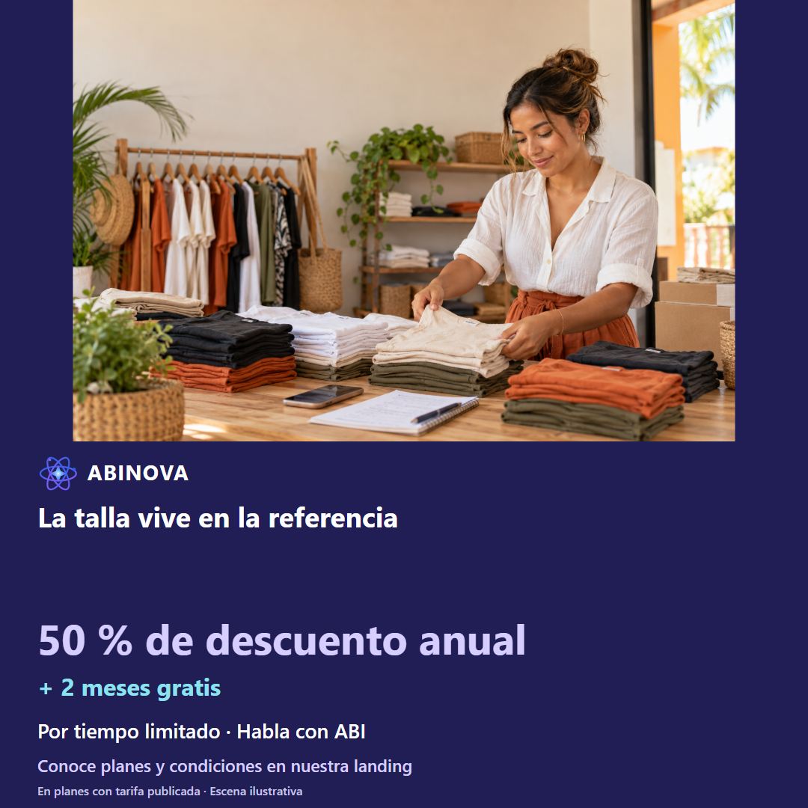
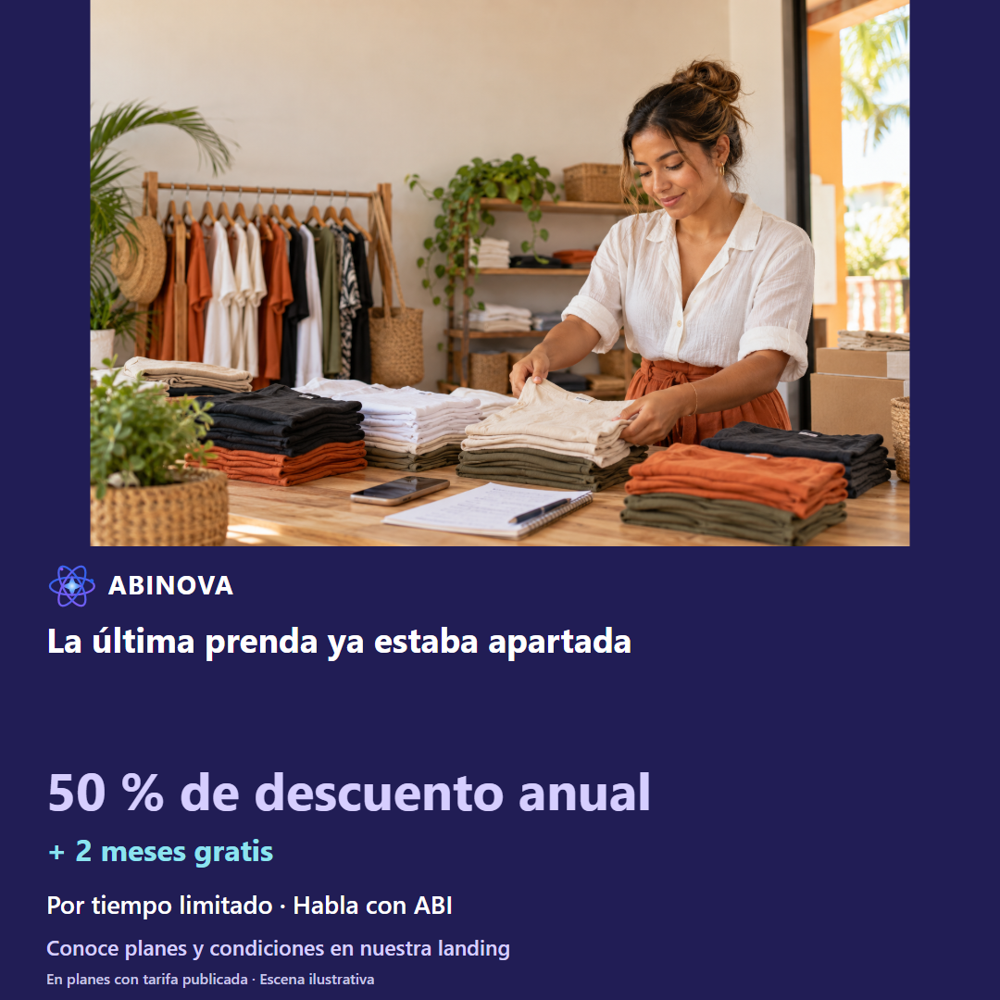
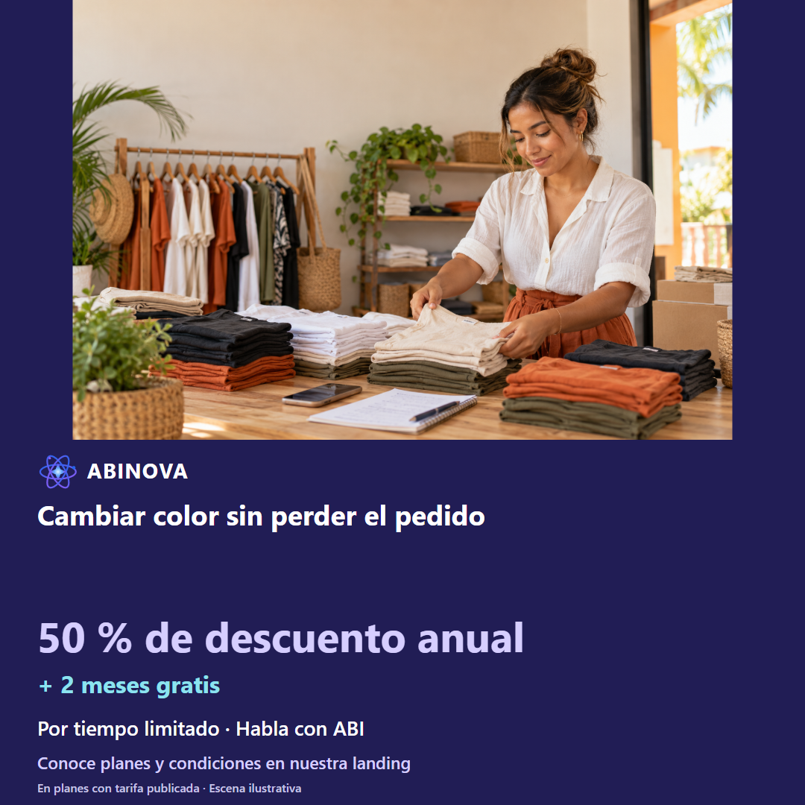

# Comercio de moda · facebook

Tres ángulos; copies A/B, guion narrado, storyboard y prompts de animación completos. Escenas ilustrativas, no testimonios ni videos grabados.

## Imágenes sugeridas locales

<!-- Fuente consolidada: 01-moda-a1.md -->

# Comercio de moda · Facebook · Ángulo 1: La talla vive en la referencia

[Fotografía original](../../recursos/originales/07.png). Escena ilustrativa, no testimonio.

## Copy A · dolor

¿Ese nombre identifica la prenda que vas a entregar? Una camiseta quedó anotada sin talla ni color. En este caso, se usa nombre genérico de prenda. Antes de decidir, comprueba lo siguiente: El catálogo tiene ambas referencias explícitas y la revisión muestra talla L. Preparar, aclarar, corregir, revisar y confirmar una vez con permisos. En ABINOVA puedes trabajar con el asistente operativo por voz o chat de administrador, según configuración y permisos. Si falta un dato o la referencia es ambigua, aclara y revisa. Solicita una demo con tallas y colores como referencias. Conoce cómo funciona en nuestra página y escríbenos por WhatsApp. Ejemplo hipotético; operación sujeta a confirmación. ABI consulta, prepara y corrige con tus permisos; tú confirmas las operaciones. Usa créditos contratados con conexión asignada por el operador, tu propia API o un modelo local opcional según hardware y configuración. La base es 1.000 tokens por crédito, ponderados por modelo; se reserva el consumo y se concilia con el uso registrado. No equivale a mensajes ni es ilimitado. Tu API y el modo local no consumen ese cupo; el consumo de tu API corresponde a tu proveedor. ABINOVA: 50 % de descuento anual en planes con tarifa publicada + 2 meses gratis. Por tiempo limitado. Conoce las condiciones en la landing y habla con ABI.

## Copy B · solución

Así se revisa: la talla vive en la referencia. El pedido confirma la referencia completa revisada. En este caso, se usa nombre genérico de prenda. Antes de decidir, comprueba lo siguiente: El catálogo tiene ambas referencias explícitas y la revisión muestra talla L. Preparar, aclarar, corregir, revisar y confirmar una vez con permisos. En ABINOVA puedes trabajar con el asistente operativo por voz o chat de administrador, según configuración y permisos. Si falta un dato o la referencia es ambigua, aclara y revisa. Solicita una demo con tallas y colores como referencias. Conoce cómo funciona en nuestra página y escríbenos por WhatsApp. Ejemplo hipotético; operación sujeta a confirmación. ABI consulta, prepara y corrige con tus permisos; tú confirmas las operaciones. Usa créditos contratados con conexión asignada por el operador, tu propia API o un modelo local opcional según hardware y configuración. La base es 1.000 tokens por crédito, ponderados por modelo; se reserva el consumo y se concilia con el uso registrado. No equivale a mensajes ni es ilimitado. Tu API y el modo local no consumen ese cupo; el consumo de tu API corresponde a tu proveedor. ABINOVA: 50 % de descuento anual en planes con tarifa publicada + 2 meses gratis. Por tiempo limitado. Conoce las condiciones en la landing y habla con ABI.

[STORYBOARD](#angulo-1-storyboard) · [PROMPTANIMACION](#angulo-1-prompt)

Verificar productos y cliente en catálogo QA. Crédito exige cliente registrado; ocasional solo efectivo/billetera. No inventar referencias ni ejecutar sobre negocio.

Asistente de voz/chat configurado; catálogo y referencias existentes; permisos de la sesión. Revisar y aclarar antes de confirmar. La interpretación puede requerir correcciones. No se garantiza entender toda instrucción.

---

<!-- Fuente consolidada: 01-moda-a1-STORYBOARD.md -->

# Comercio de moda · Facebook · Ángulo 1: La talla vive en la referencia

[Fotografía original](../../recursos/originales/07.png). Escena ilustrativa, no testimonio.

## Enfoque A · 52 s

### Escena 1 · 0–5 s

- Cámara: Plano medio del responsable; corte a pantalla legible, ritmo pausado
- Composición: Una camiseta quedó anotada sin talla ni color.
- Narración: «¿Ese nombre identifica la prenda que vas a entregar?»
- Subtítulo: «¿Ese nombre identifica la prenda que vas a entregar?»
- Evidencia: Editorial; no ejecución grabada.

### Escena 2 · 5–15 s

- Cámara: Plano cenital con esquema de proceso
- Composición: ¿Ese nombre identifica la prenda que vas a entregar?
- Narración: «La causa propuesta: se usa nombre genérico de prenda. ABI consulta, prepara y corrige con tus permisos; tú confirmas las operaciones.»
- Subtítulo: «Talla omitida en el encargo»
- Evidencia: Editorial; no ejecución grabada.

### Escena 3 · 15–27 s

- Cámara: Captura fija con acercamiento suave al campo; mantener legible la referencia
- Composición: Propuesta: escribir la instrucción en chat o dictarla con voz validada. Captura actual solo contextual.
- Narración: «Prepara para cliente ocasional una camiseta azul talla M del catálogo, efectivo y para preparar.»
- Subtítulo: «Prepara en voz o chat»
- Evidencia: Captura contextual disponible; acción específica propuesta por grabar; no ejecución grabada.

### Escena 4 · 27–37 s

- Cámara: Captura fija con acercamiento suave al campo; mantener legible la referencia
- Composición: Propuesta por grabar: corrección y nueva revisión; resaltar el cambio en explicación editorial fuera de la UI.
- Narración: «Cambia a la referencia camiseta azul talla L y conserva una unidad.»
- Subtítulo: «Corrige y revisa»
- Evidencia: Captura contextual disponible; acción específica propuesta por grabar; no ejecución grabada.

### Escena 5 · 37–45 s

- Cámara: Captura fija con acercamiento suave al campo; mantener legible la referencia
- Composición: Propuesta por grabar: revisión completa y confirmación. No representar guardado con las capturas actuales.
- Narración: «Comprueba cliente o condición ocasional, referencias, unidades y pago. Confirma una sola vez cuando esté completo.»
- Subtítulo: «Solo confirmar con datos completos»
- Evidencia: Captura contextual disponible; acción específica propuesta por grabar; no ejecución grabada.

### Escena 6 · 45–52 s

- Cámara: Captura fija con acercamiento suave al campo; mantener legible la referencia
- Composición: Pantalla de cierre tipográfica, nombre ABINOVA y CTA sin precios ni planes.
- Narración: «Solicita una demo con tallas y colores como referencias. Conoce el beneficio anual de ABINOVA.»
- Subtítulo: «50 % de descuento anual + 2 meses gratis»
- Evidencia: Editorial; no ejecución grabada.

## Enfoque B · 55 s

### Escena 1 · 0–5 s

- Cámara: Plano medio del responsable; corte a pantalla legible, ritmo pausado
- Composición: Vista previa editorial del resultado objetivo, rotulada ejemplo hipotético; la ejecución no está grabada.
- Narración: «Así se revisa: la talla vive en la referencia.»
- Subtítulo: «Así se revisa: la talla vive en la referencia.»
- Evidencia: Editorial; no ejecución grabada.

### Escena 2 · 5–18 s

- Cámara: Plano cenital con esquema de proceso
- Composición: Etiqueta física M azul frente al nombre completo en catálogo.
- Narración: «La revisión permite comprobar: El catálogo tiene ambas referencias explícitas y la revisión muestra talla L. ABI consulta, prepara y corrige con tus permisos; tú confirmas las operaciones.»
- Subtítulo: «La talla vive en la referencia»
- Evidencia: Editorial; no ejecución grabada.

### Escena 3 · 18–30 s

- Cámara: Captura fija con acercamiento suave al campo; mantener legible la referencia
- Composición: Propuesta: escribir la instrucción en chat o dictarla con voz validada. Captura actual solo contextual.
- Narración: «Prepara para cliente ocasional una camiseta azul talla M del catálogo, efectivo y para preparar.»
- Subtítulo: «Prepara en voz o chat»
- Evidencia: Captura contextual disponible; acción específica propuesta por grabar; no ejecución grabada.

### Escena 4 · 30–40 s

- Cámara: Captura fija con acercamiento suave al campo; mantener legible la referencia
- Composición: Propuesta por grabar: corrección y nueva revisión; resaltar el cambio en explicación editorial fuera de la UI.
- Narración: «Cambia a la referencia camiseta azul talla L y conserva una unidad.»
- Subtítulo: «Corrige y revisa»
- Evidencia: Captura contextual disponible; acción específica propuesta por grabar; no ejecución grabada.

### Escena 5 · 40–48 s

- Cámara: Captura fija con acercamiento suave al campo; mantener legible la referencia
- Composición: Propuesta por grabar: revisión completa y confirmación. No representar guardado con las capturas actuales.
- Narración: «Comprueba cliente o condición ocasional, referencias, unidades y pago. Confirma una sola vez cuando esté completo.»
- Subtítulo: «Solo confirmar con datos completos»
- Evidencia: Captura contextual disponible; acción específica propuesta por grabar; no ejecución grabada.

### Escena 6 · 48–55 s

- Cámara: Captura fija con acercamiento suave al campo; mantener legible la referencia
- Composición: Pantalla de cierre tipográfica, nombre ABINOVA y CTA sin precios ni planes.
- Narración: «Solicita una demo con tallas y colores como referencias. Conoce el beneficio anual de ABINOVA.»
- Subtítulo: «50 % de descuento anual + 2 meses gratis»
- Evidencia: Editorial; no ejecución grabada.

[Copy](#angulo-1-copy) · [PROMPTANIMACION](#angulo-1-prompt)

---

<!-- Fuente consolidada: 01-moda-a1-PROMPTANIMACION.md -->

# Comercio de moda · Facebook · Ángulo 1: La talla vive en la referencia

[Fotografía original](../../recursos/originales/07.png). Escena ilustrativa, no testimonio.

## Prompt A

Animación vertical 1080×1920, 52 s, español de Colombia. Referencia original: marketing/recursos/originales/07.png. Mantener foto, rostro y manos, sin redibujarlos. Movimiento suave de cámara y subtítulos en banda índigo separada de la foto. No superponer app, textos ni gráficos sobre caras. Sin panel blanco obligatorio ni gradientes. Seguir los seis tiempos del STORYBOARD A. No inventar interfaz, guardados ni funciones.  Asistente de voz/chat configurado; catálogo y referencias existentes; permisos de la sesión. Revisar y aclarar antes de confirmar. La interpretación puede requerir correcciones. No se garantiza entender toda instrucción. A/B son alternativas textuales, no exportaciones duplicadas. Apertura: ¿Ese nombre identifica la prenda que vas a entregar? CTA: Solicita una demo con tallas y colores como referencias. Escena hipotética; sin precios ni planes. Marca ABINOVA, logo estático nuevo, paleta azul índigo #4E4CDB y violeta #9E8BFF. ABI es un ser nebular 2D: enciende sus estrellas al escuchar y su corazón al responder. No superponerlo sobre rostros. Cierre: «50 % de descuento anual + 2 meses gratis · Por tiempo limitado». No mostrar importes. Empresarial: proyecto a medida; dos meses adicionales por acuerdo anual. Resaltar la labor de ABI: ABI consulta, prepara y corrige con tus permisos; tú confirmas las operaciones. No presentar la FAQ pública como agente conectado. No atribuir un SaaS multiempresa compartido en producción ni automatizaciones especializadas ya instaladas. Créditos: base de 1.000 tokens ponderados por modelo, reserva y conciliación; requiere conexión asignada por el operador. API propia y modo local no consumen el cupo incluido. No prometer mensajes ilimitados ni rendimiento local en vivo sin validar hardware.

## Prompt B

Animación vertical 1080×1920, 55 s, español de Colombia. Referencia original: marketing/recursos/originales/07.png. Mantener foto, rostro y manos, sin redibujarlos. Movimiento suave de cámara y subtítulos en banda índigo separada de la foto. No superponer app, textos ni gráficos sobre caras. Sin panel blanco obligatorio ni gradientes. Seguir los seis tiempos del STORYBOARD B. No inventar interfaz, guardados ni funciones.  Asistente de voz/chat configurado; catálogo y referencias existentes; permisos de la sesión. Revisar y aclarar antes de confirmar. La interpretación puede requerir correcciones. No se garantiza entender toda instrucción. A/B son alternativas textuales, no exportaciones duplicadas. Apertura: Así se revisa: la talla vive en la referencia. CTA: Solicita una demo con tallas y colores como referencias. Escena hipotética; sin precios ni planes. Marca ABINOVA, logo estático nuevo, paleta azul índigo #4E4CDB y violeta #9E8BFF. ABI es un ser nebular 2D: enciende sus estrellas al escuchar y su corazón al responder. No superponerlo sobre rostros. Cierre: «50 % de descuento anual + 2 meses gratis · Por tiempo limitado». No mostrar importes. Empresarial: proyecto a medida; dos meses adicionales por acuerdo anual. Resaltar la labor de ABI: ABI consulta, prepara y corrige con tus permisos; tú confirmas las operaciones. No presentar la FAQ pública como agente conectado. No atribuir un SaaS multiempresa compartido en producción ni automatizaciones especializadas ya instaladas. Créditos: base de 1.000 tokens ponderados por modelo, reserva y conciliación; requiere conexión asignada por el operador. API propia y modo local no consumen el cupo incluido. No prometer mensajes ilimitados ni rendimiento local en vivo sin validar hardware.

[Copy](#angulo-1-copy) · [STORYBOARD](#angulo-1-storyboard)

---

<!-- Fuente consolidada: 02-moda-a2.md -->

# Comercio de moda · Facebook · Ángulo 2: La última prenda ya estaba apartada

[Fotografía original](../../recursos/originales/07.png). Escena ilustrativa, no testimonio.

## Copy A · dolor

¿La exhibición coincide con el disponible? Una prenda sigue colgada aunque pertenece a un pedido abierto. En este caso, sigue en exhibición. Antes de decidir, comprueba lo siguiente: La consulta distingue físico y disponible de la referencia existente. Consultar, aclarar y contrastar con la pantalla existente. En ABINOVA puedes trabajar con el asistente operativo por voz o chat de administrador, según configuración y permisos. Si falta un dato o la referencia es ambigua, aclara y revisa. Pide una demo de apartados y disponibilidad. Conoce cómo funciona en nuestra página y escríbenos por WhatsApp. Ejemplo hipotético; consulta sin escritura. ABI consulta los datos que tu rol permite ver y te ayuda a contrastarlos. Usa créditos contratados con conexión asignada por el operador, tu propia API o un modelo local opcional según hardware y configuración. La base es 1.000 tokens por crédito, ponderados por modelo; se reserva el consumo y se concilia con el uso registrado. No equivale a mensajes ni es ilimitado. Tu API y el modo local no consumen ese cupo; el consumo de tu API corresponde a tu proveedor. ABINOVA: 50 % de descuento anual en planes con tarifa publicada + 2 meses gratis. Por tiempo limitado. Conoce las condiciones en la landing y habla con ABI.

## Copy B · solución

Así se revisa: la última prenda ya estaba apartada. El administrador revisa disponibilidad antes de ofrecer otro apartado. En este caso, sigue en exhibición. Antes de decidir, comprueba lo siguiente: La consulta distingue físico y disponible de la referencia existente. Consultar, aclarar y contrastar con la pantalla existente. En ABINOVA puedes trabajar con el asistente operativo por voz o chat de administrador, según configuración y permisos. Si falta un dato o la referencia es ambigua, aclara y revisa. Pide una demo de apartados y disponibilidad. Conoce cómo funciona en nuestra página y escríbenos por WhatsApp. Ejemplo hipotético; consulta sin escritura. ABI consulta los datos que tu rol permite ver y te ayuda a contrastarlos. Usa créditos contratados con conexión asignada por el operador, tu propia API o un modelo local opcional según hardware y configuración. La base es 1.000 tokens por crédito, ponderados por modelo; se reserva el consumo y se concilia con el uso registrado. No equivale a mensajes ni es ilimitado. Tu API y el modo local no consumen ese cupo; el consumo de tu API corresponde a tu proveedor. ABINOVA: 50 % de descuento anual en planes con tarifa publicada + 2 meses gratis. Por tiempo limitado. Conoce las condiciones en la landing y habla con ABI.

[STORYBOARD](#angulo-2-storyboard) · [PROMPTANIMACION](#angulo-2-prompt)

Solo administrador. Es una lectura: la aclaración puede requerir otra consulta o revisión de la pantalla existente; no atribuir escrituras ni confirmación de guardado.

Asistente de voz/chat configurado; catálogo y referencias existentes; permisos de la sesión. Revisar y aclarar antes de confirmar. La interpretación puede requerir correcciones. No se garantiza entender toda instrucción.

---

<!-- Fuente consolidada: 02-moda-a2-STORYBOARD.md -->

# Comercio de moda · Facebook · Ángulo 2: La última prenda ya estaba apartada

[Fotografía original](../../recursos/originales/07.png). Escena ilustrativa, no testimonio.

## Enfoque A · 50 s

### Escena 1 · 0–5 s

- Cámara: Plano medio del responsable; corte a pantalla legible, ritmo pausado
- Composición: Una prenda sigue colgada aunque pertenece a un pedido abierto.
- Narración: «¿La exhibición coincide con el disponible?»
- Subtítulo: «¿La exhibición coincide con el disponible?»
- Evidencia: Editorial; no ejecución grabada.

### Escena 2 · 5–14 s

- Cámara: Plano cenital con esquema de proceso
- Composición: ¿La exhibición coincide con el disponible?
- Narración: «La causa propuesta: sigue en exhibición. ABI consulta los datos que tu rol permite ver y te ayuda a contrastarlos.»
- Subtítulo: «Prenda apartada ofrecida otra vez»
- Evidencia: Editorial; no ejecución grabada.

### Escena 3 · 14–26 s

- Cámara: Captura fija con acercamiento suave al campo; mantener legible la referencia
- Composición: Propuesta: escribir la instrucción en chat o dictarla con voz validada. Captura actual solo contextual.
- Narración: «Consulta la referencia chaqueta negra talla M.»
- Subtítulo: «Consulta en voz o chat»
- Evidencia: Captura contextual disponible; acción específica propuesta por grabar; no ejecución grabada.

### Escena 4 · 26–36 s

- Cámara: Captura fija con acercamiento suave al campo; mantener legible la referencia
- Composición: Propuesta por grabar: corrección y nueva revisión; resaltar el cambio en explicación editorial fuera de la UI.
- Narración: «Aclara el código y revisa la disponibilidad de esa combinación exacta.»
- Subtítulo: «Corrige y revisa»
- Evidencia: Captura contextual disponible; acción específica propuesta por grabar; no ejecución grabada.

### Escena 5 · 36–44 s

- Cámara: Captura fija con acercamiento suave al campo; mantener legible la referencia
- Composición: Propuesta: contrastar recurso y período en pantalla existente, sin botón ficticio de guardar.
- Narración: «Es una consulta: aclara la referencia o el período y contrasta con la pantalla. No guarda operaciones.»
- Subtítulo: «Consultar no modifica»
- Evidencia: Captura contextual disponible; acción específica propuesta por grabar; no ejecución grabada.

### Escena 6 · 44–50 s

- Cámara: Captura fija con acercamiento suave al campo; mantener legible la referencia
- Composición: Pantalla de cierre tipográfica, nombre ABINOVA y CTA sin precios ni planes.
- Narración: «Pide una demo de apartados y disponibilidad. Conoce el beneficio anual de ABINOVA.»
- Subtítulo: «50 % de descuento anual + 2 meses gratis»
- Evidencia: Editorial; no ejecución grabada.

## Enfoque B · 54 s

### Escena 1 · 0–5 s

- Cámara: Plano medio del responsable; corte a pantalla legible, ritmo pausado
- Composición: Vista previa editorial del resultado objetivo, rotulada ejemplo hipotético; la ejecución no está grabada.
- Narración: «Así se revisa: la última prenda ya estaba apartada.»
- Subtítulo: «Así se revisa: la última prenda ya estaba apartada.»
- Evidencia: Editorial; no ejecución grabada.

### Escena 2 · 5–18 s

- Cámara: Plano cenital con esquema de proceso
- Composición: Percha con etiqueta de apartado y campo disponible en inventario.
- Narración: «La revisión permite comprobar: La consulta distingue físico y disponible de la referencia existente. ABI consulta los datos que tu rol permite ver y te ayuda a contrastarlos.»
- Subtítulo: «La última prenda ya estaba apartada»
- Evidencia: Editorial; no ejecución grabada.

### Escena 3 · 18–30 s

- Cámara: Captura fija con acercamiento suave al campo; mantener legible la referencia
- Composición: Propuesta: escribir la instrucción en chat o dictarla con voz validada. Captura actual solo contextual.
- Narración: «Consulta la referencia chaqueta negra talla M.»
- Subtítulo: «Consulta en voz o chat»
- Evidencia: Captura contextual disponible; acción específica propuesta por grabar; no ejecución grabada.

### Escena 4 · 30–40 s

- Cámara: Captura fija con acercamiento suave al campo; mantener legible la referencia
- Composición: Propuesta por grabar: corrección y nueva revisión; resaltar el cambio en explicación editorial fuera de la UI.
- Narración: «Aclara el código y revisa la disponibilidad de esa combinación exacta.»
- Subtítulo: «Corrige y revisa»
- Evidencia: Captura contextual disponible; acción específica propuesta por grabar; no ejecución grabada.

### Escena 5 · 40–48 s

- Cámara: Captura fija con acercamiento suave al campo; mantener legible la referencia
- Composición: Propuesta: contrastar recurso y período en pantalla existente, sin botón ficticio de guardar.
- Narración: «Es una consulta: aclara la referencia o el período y contrasta con la pantalla. No guarda operaciones.»
- Subtítulo: «Consultar no modifica»
- Evidencia: Captura contextual disponible; acción específica propuesta por grabar; no ejecución grabada.

### Escena 6 · 48–54 s

- Cámara: Captura fija con acercamiento suave al campo; mantener legible la referencia
- Composición: Pantalla de cierre tipográfica, nombre ABINOVA y CTA sin precios ni planes.
- Narración: «Pide una demo de apartados y disponibilidad. Conoce el beneficio anual de ABINOVA.»
- Subtítulo: «50 % de descuento anual + 2 meses gratis»
- Evidencia: Editorial; no ejecución grabada.

[Copy](#angulo-2-copy) · [PROMPTANIMACION](#angulo-2-prompt)

---

<!-- Fuente consolidada: 02-moda-a2-PROMPTANIMACION.md -->

# Comercio de moda · Facebook · Ángulo 2: La última prenda ya estaba apartada

[Fotografía original](../../recursos/originales/07.png). Escena ilustrativa, no testimonio.

## Prompt A

Animación vertical 1080×1920, 50 s, español de Colombia. Referencia original: marketing/recursos/originales/07.png. Mantener foto, rostro y manos, sin redibujarlos. Movimiento suave de cámara y subtítulos en banda índigo separada de la foto. No superponer app, textos ni gráficos sobre caras. Sin panel blanco obligatorio ni gradientes. Seguir los seis tiempos del STORYBOARD A. No inventar interfaz, guardados ni funciones.  Asistente de voz/chat configurado; catálogo y referencias existentes; permisos de la sesión. Revisar y aclarar antes de confirmar. La interpretación puede requerir correcciones. No se garantiza entender toda instrucción. A/B son alternativas textuales, no exportaciones duplicadas. Apertura: ¿La exhibición coincide con el disponible? CTA: Pide una demo de apartados y disponibilidad. Escena hipotética; sin precios ni planes. Marca ABINOVA, logo estático nuevo, paleta azul índigo #4E4CDB y violeta #9E8BFF. ABI es un ser nebular 2D: enciende sus estrellas al escuchar y su corazón al responder. No superponerlo sobre rostros. Cierre: «50 % de descuento anual + 2 meses gratis · Por tiempo limitado». No mostrar importes. Empresarial: proyecto a medida; dos meses adicionales por acuerdo anual. Resaltar la labor de ABI: ABI consulta los datos que tu rol permite ver y te ayuda a contrastarlos. No presentar la FAQ pública como agente conectado. No atribuir un SaaS multiempresa compartido en producción ni automatizaciones especializadas ya instaladas. Créditos: base de 1.000 tokens ponderados por modelo, reserva y conciliación; requiere conexión asignada por el operador. API propia y modo local no consumen el cupo incluido. No prometer mensajes ilimitados ni rendimiento local en vivo sin validar hardware.

## Prompt B

Animación vertical 1080×1920, 54 s, español de Colombia. Referencia original: marketing/recursos/originales/07.png. Mantener foto, rostro y manos, sin redibujarlos. Movimiento suave de cámara y subtítulos en banda índigo separada de la foto. No superponer app, textos ni gráficos sobre caras. Sin panel blanco obligatorio ni gradientes. Seguir los seis tiempos del STORYBOARD B. No inventar interfaz, guardados ni funciones.  Asistente de voz/chat configurado; catálogo y referencias existentes; permisos de la sesión. Revisar y aclarar antes de confirmar. La interpretación puede requerir correcciones. No se garantiza entender toda instrucción. A/B son alternativas textuales, no exportaciones duplicadas. Apertura: Así se revisa: la última prenda ya estaba apartada. CTA: Pide una demo de apartados y disponibilidad. Escena hipotética; sin precios ni planes. Marca ABINOVA, logo estático nuevo, paleta azul índigo #4E4CDB y violeta #9E8BFF. ABI es un ser nebular 2D: enciende sus estrellas al escuchar y su corazón al responder. No superponerlo sobre rostros. Cierre: «50 % de descuento anual + 2 meses gratis · Por tiempo limitado». No mostrar importes. Empresarial: proyecto a medida; dos meses adicionales por acuerdo anual. Resaltar la labor de ABI: ABI consulta los datos que tu rol permite ver y te ayuda a contrastarlos. No presentar la FAQ pública como agente conectado. No atribuir un SaaS multiempresa compartido en producción ni automatizaciones especializadas ya instaladas. Créditos: base de 1.000 tokens ponderados por modelo, reserva y conciliación; requiere conexión asignada por el operador. API propia y modo local no consumen el cupo incluido. No prometer mensajes ilimitados ni rendimiento local en vivo sin validar hardware.

[Copy](#angulo-2-copy) · [STORYBOARD](#angulo-2-storyboard)

---

<!-- Fuente consolidada: 03-moda-a3.md -->

# Comercio de moda · Facebook · Ángulo 3: Cambiar color sin perder el pedido

[Fotografía original](../../recursos/originales/07.png). Escena ilustrativa, no testimonio.

## Copy A · dolor

¿Solo cambia la referencia que te pidió? El cliente elige color negro al final y mantiene su pantalón. En este caso, se reescribe el pedido completo. Antes de decidir, comprueba lo siguiente: Solo cambia la camiseta; el pantalón y el pago permanecen. Preparar, aclarar, corregir, revisar y confirmar una vez con permisos. En ABINOVA puedes trabajar con el asistente operativo por voz o chat de administrador, según configuración y permisos. Si falta un dato o la referencia es ambigua, aclara y revisa. Solicita una demo cambiando una referencia de moda. Conoce cómo funciona en nuestra página y escríbenos por WhatsApp. Ejemplo hipotético; operación sujeta a confirmación. ABI consulta, prepara y corrige con tus permisos; tú confirmas las operaciones. Usa créditos contratados con conexión asignada por el operador, tu propia API o un modelo local opcional según hardware y configuración. La base es 1.000 tokens por crédito, ponderados por modelo; se reserva el consumo y se concilia con el uso registrado. No equivale a mensajes ni es ilimitado. Tu API y el modo local no consumen ese cupo; el consumo de tu API corresponde a tu proveedor. ABINOVA: 50 % de descuento anual en planes con tarifa publicada + 2 meses gratis. Por tiempo limitado. Conoce las condiciones en la landing y habla con ABI.

## Copy B · solución

Así se revisa: cambiar color sin perder el pedido. La revisión conserva las dos prendas antes de confirmar. En este caso, se reescribe el pedido completo. Antes de decidir, comprueba lo siguiente: Solo cambia la camiseta; el pantalón y el pago permanecen. Preparar, aclarar, corregir, revisar y confirmar una vez con permisos. En ABINOVA puedes trabajar con el asistente operativo por voz o chat de administrador, según configuración y permisos. Si falta un dato o la referencia es ambigua, aclara y revisa. Solicita una demo cambiando una referencia de moda. Conoce cómo funciona en nuestra página y escríbenos por WhatsApp. Ejemplo hipotético; operación sujeta a confirmación. ABI consulta, prepara y corrige con tus permisos; tú confirmas las operaciones. Usa créditos contratados con conexión asignada por el operador, tu propia API o un modelo local opcional según hardware y configuración. La base es 1.000 tokens por crédito, ponderados por modelo; se reserva el consumo y se concilia con el uso registrado. No equivale a mensajes ni es ilimitado. Tu API y el modo local no consumen ese cupo; el consumo de tu API corresponde a tu proveedor. ABINOVA: 50 % de descuento anual en planes con tarifa publicada + 2 meses gratis. Por tiempo limitado. Conoce las condiciones en la landing y habla con ABI.

[STORYBOARD](#angulo-3-storyboard) · [PROMPTANIMACION](#angulo-3-prompt)

Verificar productos y cliente en catálogo QA. Crédito exige cliente registrado; ocasional solo efectivo/billetera. No inventar referencias ni ejecutar sobre negocio.

Asistente de voz/chat configurado; catálogo y referencias existentes; permisos de la sesión. Revisar y aclarar antes de confirmar. La interpretación puede requerir correcciones. No se garantiza entender toda instrucción.

---

<!-- Fuente consolidada: 03-moda-a3-STORYBOARD.md -->

# Comercio de moda · Facebook · Ángulo 3: Cambiar color sin perder el pedido

[Fotografía original](../../recursos/originales/07.png). Escena ilustrativa, no testimonio.

## Enfoque A · 51 s

### Escena 1 · 0–5 s

- Cámara: Plano medio del responsable; corte a pantalla legible, ritmo pausado
- Composición: El cliente elige color negro al final y mantiene su pantalón.
- Narración: «¿Solo cambia la referencia que te pidió?»
- Subtítulo: «¿Solo cambia la referencia que te pidió?»
- Evidencia: Editorial; no ejecución grabada.

### Escena 2 · 5–14 s

- Cámara: Plano cenital con esquema de proceso
- Composición: ¿Solo cambia la referencia que te pidió?
- Narración: «La causa propuesta: se reescribe el pedido completo. ABI consulta, prepara y corrige con tus permisos; tú confirmas las operaciones.»
- Subtítulo: «Color confundido al corregir»
- Evidencia: Editorial; no ejecución grabada.

### Escena 3 · 14–26 s

- Cámara: Captura fija con acercamiento suave al campo; mantener legible la referencia
- Composición: Propuesta: escribir la instrucción en chat o dictarla con voz validada. Captura actual solo contextual.
- Narración: «Prepara para cliente ocasional una camiseta azul talla M y un pantalón negro talla M, billetera y para preparar.»
- Subtítulo: «Prepara en voz o chat»
- Evidencia: Captura contextual disponible; acción específica propuesta por grabar; no ejecución grabada.

### Escena 4 · 26–36 s

- Cámara: Captura fija con acercamiento suave al campo; mantener legible la referencia
- Composición: Propuesta por grabar: corrección y nueva revisión; resaltar el cambio en explicación editorial fuera de la UI.
- Narración: «Usa camiseta negra talla M; conserva el pantalón, cantidades y billetera.»
- Subtítulo: «Corrige y revisa»
- Evidencia: Captura contextual disponible; acción específica propuesta por grabar; no ejecución grabada.

### Escena 5 · 36–44 s

- Cámara: Captura fija con acercamiento suave al campo; mantener legible la referencia
- Composición: Propuesta por grabar: revisión completa y confirmación. No representar guardado con las capturas actuales.
- Narración: «Comprueba cliente o condición ocasional, referencias, unidades y pago. Confirma una sola vez cuando esté completo.»
- Subtítulo: «Solo confirmar con datos completos»
- Evidencia: Captura contextual disponible; acción específica propuesta por grabar; no ejecución grabada.

### Escena 6 · 44–51 s

- Cámara: Captura fija con acercamiento suave al campo; mantener legible la referencia
- Composición: Pantalla de cierre tipográfica, nombre ABINOVA y CTA sin precios ni planes.
- Narración: «Solicita una demo cambiando una referencia de moda. Conoce el beneficio anual de ABINOVA.»
- Subtítulo: «50 % de descuento anual + 2 meses gratis»
- Evidencia: Editorial; no ejecución grabada.

## Enfoque B · 54 s

### Escena 1 · 0–5 s

- Cámara: Plano medio del responsable; corte a pantalla legible, ritmo pausado
- Composición: Vista previa editorial del resultado objetivo, rotulada ejemplo hipotético; la ejecución no está grabada.
- Narración: «Así se revisa: cambiar color sin perder el pedido.»
- Subtítulo: «Así se revisa: cambiar color sin perder el pedido.»
- Evidencia: Editorial; no ejecución grabada.

### Escena 2 · 5–17 s

- Cámara: Plano cenital con esquema de proceso
- Composición: Camiseta azul cambia a negra; pantalón y medio de pago siguen visibles.
- Narración: «La revisión permite comprobar: Solo cambia la camiseta; el pantalón y el pago permanecen. ABI consulta, prepara y corrige con tus permisos; tú confirmas las operaciones.»
- Subtítulo: «Cambiar color sin perder el pedido»
- Evidencia: Editorial; no ejecución grabada.

### Escena 3 · 17–29 s

- Cámara: Captura fija con acercamiento suave al campo; mantener legible la referencia
- Composición: Propuesta: escribir la instrucción en chat o dictarla con voz validada. Captura actual solo contextual.
- Narración: «Prepara para cliente ocasional una camiseta azul talla M y un pantalón negro talla M, billetera y para preparar.»
- Subtítulo: «Prepara en voz o chat»
- Evidencia: Captura contextual disponible; acción específica propuesta por grabar; no ejecución grabada.

### Escena 4 · 29–39 s

- Cámara: Captura fija con acercamiento suave al campo; mantener legible la referencia
- Composición: Propuesta por grabar: corrección y nueva revisión; resaltar el cambio en explicación editorial fuera de la UI.
- Narración: «Usa camiseta negra talla M; conserva el pantalón, cantidades y billetera.»
- Subtítulo: «Corrige y revisa»
- Evidencia: Captura contextual disponible; acción específica propuesta por grabar; no ejecución grabada.

### Escena 5 · 39–47 s

- Cámara: Captura fija con acercamiento suave al campo; mantener legible la referencia
- Composición: Propuesta por grabar: revisión completa y confirmación. No representar guardado con las capturas actuales.
- Narración: «Comprueba cliente o condición ocasional, referencias, unidades y pago. Confirma una sola vez cuando esté completo.»
- Subtítulo: «Solo confirmar con datos completos»
- Evidencia: Captura contextual disponible; acción específica propuesta por grabar; no ejecución grabada.

### Escena 6 · 47–54 s

- Cámara: Captura fija con acercamiento suave al campo; mantener legible la referencia
- Composición: Pantalla de cierre tipográfica, nombre ABINOVA y CTA sin precios ni planes.
- Narración: «Solicita una demo cambiando una referencia de moda. Conoce el beneficio anual de ABINOVA.»
- Subtítulo: «50 % de descuento anual + 2 meses gratis»
- Evidencia: Editorial; no ejecución grabada.

[Copy](#angulo-3-copy) · [PROMPTANIMACION](#angulo-3-prompt)

---

<!-- Fuente consolidada: 03-moda-a3-PROMPTANIMACION.md -->

# Comercio de moda · Facebook · Ángulo 3: Cambiar color sin perder el pedido

[Fotografía original](../../recursos/originales/07.png). Escena ilustrativa, no testimonio.

## Prompt A

Animación vertical 1080×1920, 51 s, español de Colombia. Referencia original: marketing/recursos/originales/07.png. Mantener foto, rostro y manos, sin redibujarlos. Movimiento suave de cámara y subtítulos en banda índigo separada de la foto. No superponer app, textos ni gráficos sobre caras. Sin panel blanco obligatorio ni gradientes. Seguir los seis tiempos del STORYBOARD A. No inventar interfaz, guardados ni funciones.  Asistente de voz/chat configurado; catálogo y referencias existentes; permisos de la sesión. Revisar y aclarar antes de confirmar. La interpretación puede requerir correcciones. No se garantiza entender toda instrucción. A/B son alternativas textuales, no exportaciones duplicadas. Apertura: ¿Solo cambia la referencia que te pidió? CTA: Solicita una demo cambiando una referencia de moda. Escena hipotética; sin precios ni planes. Marca ABINOVA, logo estático nuevo, paleta azul índigo #4E4CDB y violeta #9E8BFF. ABI es un ser nebular 2D: enciende sus estrellas al escuchar y su corazón al responder. No superponerlo sobre rostros. Cierre: «50 % de descuento anual + 2 meses gratis · Por tiempo limitado». No mostrar importes. Empresarial: proyecto a medida; dos meses adicionales por acuerdo anual. Resaltar la labor de ABI: ABI consulta, prepara y corrige con tus permisos; tú confirmas las operaciones. No presentar la FAQ pública como agente conectado. No atribuir un SaaS multiempresa compartido en producción ni automatizaciones especializadas ya instaladas. Créditos: base de 1.000 tokens ponderados por modelo, reserva y conciliación; requiere conexión asignada por el operador. API propia y modo local no consumen el cupo incluido. No prometer mensajes ilimitados ni rendimiento local en vivo sin validar hardware.

## Prompt B

Animación vertical 1080×1920, 54 s, español de Colombia. Referencia original: marketing/recursos/originales/07.png. Mantener foto, rostro y manos, sin redibujarlos. Movimiento suave de cámara y subtítulos en banda índigo separada de la foto. No superponer app, textos ni gráficos sobre caras. Sin panel blanco obligatorio ni gradientes. Seguir los seis tiempos del STORYBOARD B. No inventar interfaz, guardados ni funciones.  Asistente de voz/chat configurado; catálogo y referencias existentes; permisos de la sesión. Revisar y aclarar antes de confirmar. La interpretación puede requerir correcciones. No se garantiza entender toda instrucción. A/B son alternativas textuales, no exportaciones duplicadas. Apertura: Así se revisa: cambiar color sin perder el pedido. CTA: Solicita una demo cambiando una referencia de moda. Escena hipotética; sin precios ni planes. Marca ABINOVA, logo estático nuevo, paleta azul índigo #4E4CDB y violeta #9E8BFF. ABI es un ser nebular 2D: enciende sus estrellas al escuchar y su corazón al responder. No superponerlo sobre rostros. Cierre: «50 % de descuento anual + 2 meses gratis · Por tiempo limitado». No mostrar importes. Empresarial: proyecto a medida; dos meses adicionales por acuerdo anual. Resaltar la labor de ABI: ABI consulta, prepara y corrige con tus permisos; tú confirmas las operaciones. No presentar la FAQ pública como agente conectado. No atribuir un SaaS multiempresa compartido en producción ni automatizaciones especializadas ya instaladas. Créditos: base de 1.000 tokens ponderados por modelo, reserva y conciliación; requiere conexión asignada por el operador. API propia y modo local no consumen el cupo incluido. No prometer mensajes ilimitados ni rendimiento local en vivo sin validar hardware.

[Copy](#angulo-3-copy) · [STORYBOARD](#angulo-3-storyboard)

---

